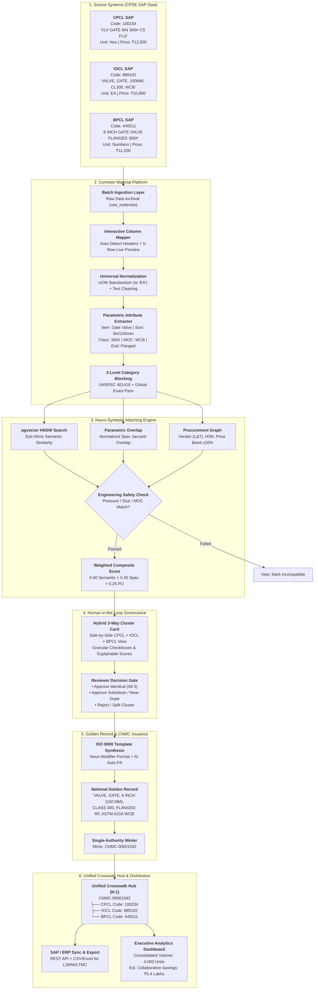
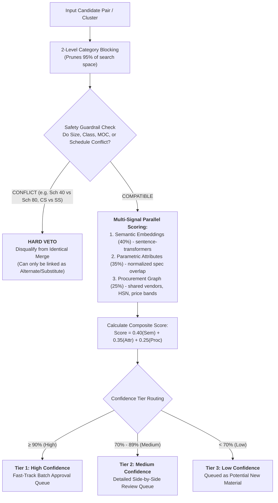
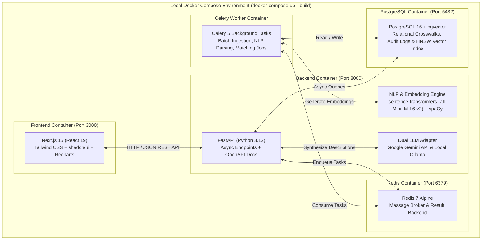
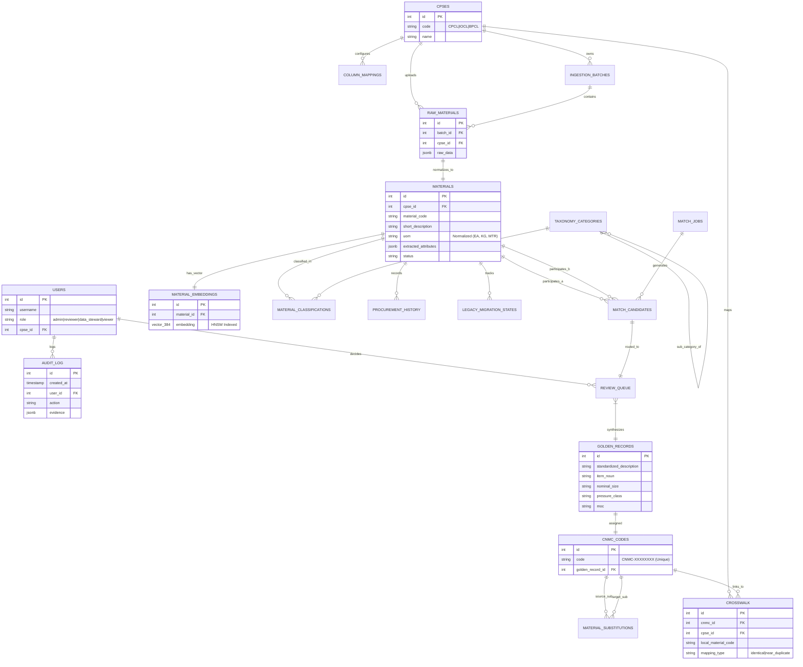
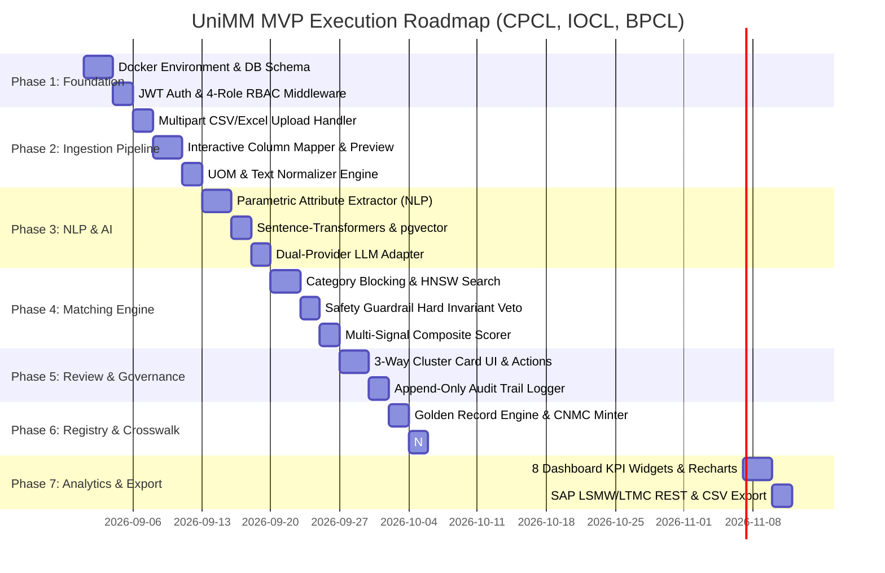

# National Unified Material Master Framework (UniMM)
## System Implementation & Visual Architecture Specification (v0.1)
**"One Nation — One Material Code" (Enterprise Scope: CPCL, IOCL, BPCL)**

---

## 1. Executive Summary & Objective

Central Public Sector Enterprises (CPSEs) in the Indian Oil & Gas sector (**CPCL**, **IOCL**, and **BPCL**) procure and maintain large volumes of identical or functionally equivalent materials. However, because each enterprise runs separate SAP/ERP instances with localized naming conventions, varying units of measure (UOM), and disparate material numbers, material data remains fragmented.

```
┌─────────────────────────────────────────────────────────────────────────────────────────────────────────┐
│                                       NATIONAL HARMONIZATION GOAL                                       │
│                                                                                                         │
│   CPCL SAP Extract ──────┐                                       ┌──────► Single CNMC Golden Record     │
│   IOCL SAP Extract ──────┼─────► [ AI-Powered UniMM Platform ] ──┼──────► N:1 Crosswalk Hub             │
│   BPCL SAP Extract ──────┘                                       └──────► Demand Aggregation & Savings  │
└─────────────────────────────────────────────────────────────────────────────────────────────────────────┘
```

### Strategic Outcomes:
- **Harmonized National Master**: AI-driven deduplication and classification across CPCL, IOCL, and BPCL.
- **One Nation — One Material Code**: Issue a unique **Common National Material Code (`CNMC-XXXXXXXX`)** for identical items while preserving local CPSE code mappings.
- **Demand Aggregation & Savings**: Combine procurement volumes across enterprises to eliminate price discrepancies and maximize bulk savings.
- **Engineering Safety Guardrails**: Deterministic rules preventing false-positive merges of safety-critical materials.
- **Enterprise Governance**: Mandatory Human-in-the-Loop review with an append-only audit trail.

---

## 2. End-to-End Visual System Architecture



---

## 3. The 3-to-1 Unification Journey (Detailed Data Flow)

Here is the exact lifecycle of how three disparate records from CPCL, IOCL, and BPCL are harmonized into one National Golden Record:

```mermaid
graph TD
    subgraph Step1["Step 1: Raw Ingestion (Source Isolation Preserved)"]
        A1["CPCL Raw Record<br/>• Code: 100234<br/>• Desc: 'VLV GATE 6IN 300# CS FLG'<br/>• UOM: Nos | Price: ₹12,500<br/>• Vendor: L&T Valves"]
        A2["IOCL Raw Record<br/>• Code: 889102<br/>• Desc: 'VALVE, GATE, 150MM, CL300, WCB'<br/>• UOM: EA | Price: ₹10,800<br/>• Vendor: L&T Valves"]
        A3["BPCL Raw Record<br/>• Code: 445511<br/>• Desc: '6 INCH GATE VALVE FLANGED 300#'<br/>• UOM: Numbers | Price: ₹11,200<br/>• Vendor: Microfinish"]
    end

    subgraph Step2["Step 2: Normalization & NLP Attribute Extraction"]
        B1["Standardized Attributes (All 3):<br/>• Item Type: Gate Valve<br/>• Nominal Size: 6 Inch / 150 mm<br/>• Pressure Rating: Class 300#<br/>• Material of Construction: Carbon Steel (WCB)<br/>• End Connection: Flanged RF<br/>• Standard UOM: EA (Each)"]
    end

    subgraph Step3["Step 3: Neuro-Symbolic Matching Engine"]
        C1["Matching Signals & Guardrails:<br/>• Vector Semantic Similarity: 94.2%<br/>• Parametric Attribute Overlap: 100.0%<br/>• Procurement History Overlap: 88.5% (Shared L&T Vendor)<br/>• Safety Invariant Check: PASSED<br/>• Composite Score: 94.8% (Tier: HIGH)"]
    end

    subgraph Step4["Step 4: Human-in-the-Loop Review Queue"]
        D1["Reviewer Action:<br/>Reviewer inspects 3-way cluster card & clicks:<br/>[ Approve — Identical (Mint Golden Record) ]"]
    end

    subgraph Step5["Step 5: Golden Record Synthesis & CNMC Code Issuance"]
        E1["Golden Record Description (ISO 8000 Format):<br/>'VALVE, GATE, 6 INCH (150 MM), CLASS 300, FLANGED RF, ASTM A216 WCB'<br/>Single National Code Minted: CNMC-00001042"]
    end

    subgraph Step6["Step 6: Unified Crosswalk Hub (N:1 Link)"]
        F1["National Registry Crosswalk Entry:<br/>CNMC-00001042<br/>├── CPCL Local Material Code: 100234<br/>├── IOCL Local Material Code: 889102<br/>└── BPCL Local Material Code: 445511"]
    end

    Step1 --> Step2 --> Step3 --> Step4 --> Step5 --> Step6
```



---

## 4. Neuro-Symbolic Matching Engine & Safety Guardrails

The platform uses a balanced **Neuro-Symbolic Engine** that combines dense vector embeddings with deterministic engineering safety guardrails.



### Safety Veto Matrix:
| Parameter | Record A | Record B | Engine Action | Rationale |
|---|---|---|---|---|
| **Pressure Class** | Class 150 | Class 300 | ❌ **HARD VETO** | Class 300 operates at double the pressure; mixing them up is a severe refinery hazard. |
| **Pipe Schedule** | Sch 40 | Sch 80 | ❌ **HARD VETO** | Schedule 80 has double the wall thickness; non-interchangeable under pressure. |
| **Material (MOC)** | CS (A216 WCB) | SS316 | ❌ **HARD VETO** | Stainless Steel provides acid/corrosion resistance; Carbon Steel would corrode. |
| **Size Unit** | 6 Inch | 150 mm | ✅ **PASSED** | Identical physical size normalized across Imperial and Metric systems. |
| **Abbreviation** | VLV GT FLG | VALVE GATE FLANGED | ✅ **PASSED** | Identical semantic concept resolved by NLP & vector embeddings. |

---

## 5. Technology Stack & Local Docker Topology



---

## 6. Entity Relationship Diagram (ERD — 17 Tables)



---

## 7. Interactive UI Wireframes

### Wireframe 1: Ingestion & Interactive Column Mapper UI
```
┌────────────────────────────────────────────────────────────────────────────────────────────────────────┐
│ UniMM > Ingestion > Upload SAP Extract                                                [ User: steward ] │
├────────────────────────────────────────────────────────────────────────────────────────────────────────┤
│ Selected CPSE: [ IOCL SAP ▼ ]        File: iocl_materials_2026.xlsx (34.2 MB - 45,000 rows)            │
├────────────────────────────────────────────────────────────────────────────────────────────────────────┤
│ COLUMN MAPPING PROFILE:                                                                                │
│ Source Column (IOCL)           Detected Standard Field          Confidence    Action                   │
│ ────────────────────────────────────────────────────────────────────────────────────────────────────── │
│ MATERIAL_NO                    ──► material_code                [ 99% High ]  [ Validated ✓ ]          │
│ ITEM_SPEC                      ──► short_description            [ 98% High ]  [ Validated ✓ ]          │
│ UNIT_OF_MEASURE                ──► uom                          [ 95% High ]  [ Validated ✓ ]          │
│ LAST_PO_PRICE                  ──► base_price                   [ 92% High ]  [ Validated ✓ ]          │
│ VENDOR_NAME                    ──► vendor_name                  [ 94% High ]  [ Validated ✓ ]          │
├────────────────────────────────────────────────────────────────────────────────────────────────────────┤
│ LIVE 5-ROW NORMALIZATION PREVIEW:                                                                      │
│ Row │ Local Code │ Raw Description                 │ Normalized Description             │ UOM  │ Price│
│ ────┼────────────┼─────────────────────────────────┼────────────────────────────────────┼──────┼──────│
│ 1   │ 889102     │ VALVE, GATE, 150MM, CL300, WCB  │ VALVE, GATE, 150MM, CLASS 300, WCB │ EA   │10,800│
│ 2   │ 889103     │ PIPE CS SMLS SCH40 4 INCH       │ PIPE, CARBON STEEL, SEAMLESS, 4",..│ MTR  │ 2,450│
├────────────────────────────────────────────────────────────────────────────────────────────────────────┤
│ [ Save Mapping Profile ]                         [ Cancel ]    [ Confirm & Start Batch Ingestion ➔ ]   │
└────────────────────────────────────────────────────────────────────────────────────────────────────────┘
```

### Wireframe 2: Human-in-the-Loop 3-Way Cluster Card Review Screen
```
┌────────────────────────────────────────────────────────────────────────────────────────────────────────┐
│ UniMM > Review Queue > Cluster #1042 — Category: 401416 (Valves)             [ Confidence: 94.8% High ]│
├────────────────────────────────────────────────────────────────────────────────────────────────────────┤
│ MULTI-CPSE MATCH CANDIDATES:                                                                           │
│                                                                                                        │
│ [✓] CPCL SAP (Code: 100234)                                                                            │
│     Raw Text: "VLV GATE 6IN 300# CS FLG"             UOM: Nos      Last PO: ₹12,500   Vendor: L&T      │
│     Parsed:   [Size: 6" (150mm)] [Rating: 300#] [MOC: Carbon Steel (WCB)] [End: Flanged Raised Face]   │
│                                                                                                        │
│ [✓] IOCL SAP (Code: 889102)                                                                            │
│     Raw Text: "VALVE, GATE, 150MM, CL300, WCB"       UOM: EA       Last PO: ₹10,800   Vendor: L&T      │
│     Parsed:   [Size: 150mm (6")] [Rating: Class 300] [MOC: ASTM A216 WCB] [End: Flanged Raised Face]   │
│                                                                                                        │
│ [✓] BPCL SAP (Code: 445511)                                                                            │
│     Raw Text: "6 INCH GATE VALVE FLANGED 300#"       UOM: Numbers  Last PO: ₹11,200   Vendor: Microfin │
│     Parsed:   [Size: 6" (150mm)] [Rating: 300#] [MOC: Carbon Steel] [End: Flanged Raised Face]         │
├────────────────────────────────────────────────────────────────────────────────────────────────────────┤
│ MATCH SCORE BREAKDOWN:                                                                                 │
│ • Semantic Similarity: 94.2%  • Attribute Overlap: 100%  • PO History: 88.5%  • Safety Check: PASSED ✓ │
├────────────────────────────────────────────────────────────────────────────────────────────────────────┤
│ PROPOSED GOLDEN RECORD (ISO 8000 Noun-Modifier Format - Editable):                                     │
│ [ VALVE, GATE, 6 INCH (150 MM), CLASS 300, FLANGED RF, ASTM A216 WCB                                 ] │
├────────────────────────────────────────────────────────────────────────────────────────────────────────┤
│ REVIEWER ACTIONS:                                                                                      │
│ [ ✓ Approve — Identical (Mint CNMC) ]  [ ⇄ Approve — Substitute ]  [ ✗ Reject Match ]  [ Split Items ] │
│ Reviewer Notes: [ Verified ASME B16.34 specs and shared L&T supply history. Approved.               ] │
└────────────────────────────────────────────────────────────────────────────────────────────────────────┘
```

---

## 8. Executive Analytics Dashboard Layout (All 8 Widgets)

```
┌────────────────────────────────────────────────────────────────────────────────────────────────────────┐
│ UniMM EXECUTIVE ANALYTICS DASHBOARD                                            [ Refresh Data ⟳ ]      │
├──────────────────────────────────────┬───────────────────────────────────┬─────────────────────────────┤
│ [W1] STANDARDIZATION COVERAGE        │ [W2] DUPLICATE DETECTION SUMMARY  │ [W3] REVIEW QUEUE STATUS    │
│ National:  [████████████░░░] 78.4%   │ Identical Mappings:        14,210 │ Pending (High):         342 │
│ CPCL:      [███████████░░░░] 74.1%   │ Near-Duplicates:            3,450 │ Pending (Medium):       819 │
│ IOCL:      [██████████████░] 89.2%   │ Substitutes / Alternates:   1,890 │ Approved Today:       1,240 │
│ BPCL:      [███████████░░░░] 72.0%   │ Total Duplicates Resolved: 19,550 │ Rejected:                45 │
├──────────────────────────────────────┴───────────────────────────────────┴─────────────────────────────┤
│ [W4] DEMAND AGGREGATION & COLLABORATIVE PROCUREMENT SAVINGS TABLE                                      │
│ CNMC Code     │ Material Description            │ CPCL Vol │ IOCL Vol │ BPCL Vol │ Total Vol│ Est. Savings│
│ ──────────────┼─────────────────────────────────┼──────────┼──────────┼──────────┼──────────┼─────────────│
│ CNMC-00001042 │ VALVE, GATE, 6" 300# WCB FLG    │ 500 EA   │ 2,000 EA │ 1,500 EA │ 4,000 EA │  ₹5.40 Lakhs│
│ CNMC-00001088 │ PIPE CS SMLS 4" SCH40 ASTM A106 │ 1,200 M  │ 4,500 M  │ 3,000 M  │ 8,700 M  │ ₹12.80 Lakhs│
│ CNMC-00002140 │ GASKET SPIRAL WOUND 6" 300# SS  │ 2,000 EA │ 8,000 EA │ 5,000 EA │15,000 EA │  ₹3.20 Lakhs│
├─────────────────────────────────────────┬───────────────────────────────┬──────────────────────────────┤
│ [W5] DATA QUALITY HEATMAP               │ [W6] 3-WAY CPSE OVERLAP VENN  │ [W7] PIPELINE STATUS         │
│ Field       │ CPCL  │ IOCL  │ BPCL      │      ( CPCL ∩ IOCL ∩ BPCL )   │ • Batch #109: Completed (100%)│
│ ────────────┼───────┼───────┼────────── │          Total: 8,420 Items   │ • Matching Job #44: 82% Active│
│ Size / Dim  │  96%  │  99%  │  94%      │                               │ • Embeddings: 45k Generated   │
│ Pressure Cl │  89%  │  97%  │  91%      │  CPCL ∩ IOCL: 11,200          ├──────────────────────────────┤
│ MOC / Spec  │  84%  │  95%  │  88%      │  IOCL ∩ BPCL: 14,100          │ [W8] TAXONOMY DISTRIBUTION   │
│ Vendor Code │  98%  │  99%  │  97%      │  CPCL ∩ BPCL:  9,800          │ Valves: 32% | Pipes: 28% ... │
└─────────────────────────────────────────┴───────────────────────────────┴──────────────────────────────┘
```

---

## 9. Phased Vertical Slice Implementation Roadmap



---

## 10. Local Run & Verification Commands

```bash
# Start all containers (PostgreSQL+pgvector, Redis, FastAPI backend, Celery worker, Next.js UI)
docker-compose up --build

# Access Swagger API documentation
open http://localhost:8000/docs

# Access Web Dashboard & Review UI
open http://localhost:3000

# Execute backend automated test suite
docker-compose exec backend pytest -v
```
