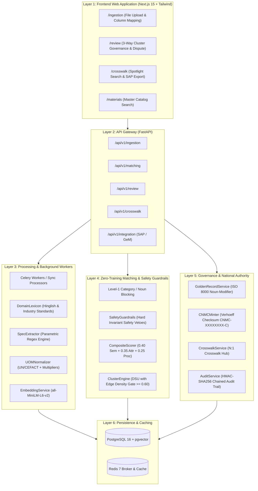
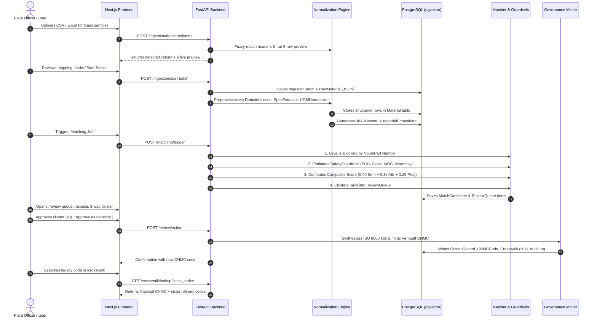

# National Unified Material Master (UniMM)
## Architecture, End-to-End Pipeline & Testing Guide

> **Purpose of this Document:**  
> This guide provides a complete, transparent explanation of **how the entire UniMM system works** (from UI input down to the backend database), followed by an actionable, step-by-step **Testing & Verification Playbook** so both humans and AI agents can verify whether every component is functioning properly.

---

## 1. System Mission & Core Principle

In India's public sector, different Central Public Sector Enterprises (CPSEs) such as **CPCL**, **IOCL**, and **BPCL** maintain separate ERP catalogs (e.g. SAP ECC, S/4HANA). The same physical item (e.g., a 6" Class 300# Gate Valve) is described with different part numbers, colloquial jargon, and unit formats.

**UniMM (Unified Material Master)** harmonizes these disparate items into a single authoritative **Common National Material Code (`CNMC-XXXXXXXX-C`)** while preserving local ERP legacy mappings and synthesizing ISO 8000 compliant descriptions.

```
┌────────────────────────────────────────────────────────────────────────────────────────┐
│                          ZERO-TRAINING ARCHITECTURE PRINCIPLE                          │
│                                                                                        │
│  ❌ NO Model Re-Training Pipelines       ✅ Out-of-the-box Embeddings (all-MiniLM-L6)  │
│  ❌ NO Opaque Weights / Hallucinations   ✅ Hard Deterministic Safety Guardrails       │
│  ❌ NO Fragile Graph Collapses           ✅ DSU Clustering with Coherence Gating       │
│  ❌ NO Unvalidated Numbers               ✅ Verhoeff Aerospace Typo Checksum           │
└────────────────────────────────────────────────────────────────────────────────────────┘
```

---

## 2. System Architecture & Topology



---

## 3. The Final End-to-End Pipeline (How Data Moves Step-by-Step)

Here is the exact chunk-by-chunk trace from the moment a user uploads a file in the UI to the minting of a national code.



---

### Step-by-Step Data Transformation Walkthrough

Let us trace a real example through every stage:

| Stage | Input / Operation | Output Result |
|---|---|---|
| **Raw CPCL Input** | `VLV GATE 6IN 300# CS FLG`, UOM: `Nos`, Price: `₹12,500` | Stored in `raw_materials` table as raw JSON. |
| **Raw IOCL Input** | `VALVE, GATE, 150MM, CL300, WCB`, UOM: `EA`, Price: `₹10,800` | Stored in `raw_materials` table as raw JSON. |
| **Raw BPCL Input** | `6 INCH GATE VALVE FLANGED 300#`, UOM: `Numbers`, Price: `₹11,200` | Stored in `raw_materials` table as raw JSON. |
| **UOM Normalization** | `UOMNormalizer.normalize_uom()` | All normalized to `EA`. |
| **Spec Extraction** | `SpecExtractor.extract_specs()` | **Noun:** `VALVE, GATE`<br/>**Size:** `6 INCH (150 MM)`<br/>**Pressure:** `CLASS 300#`<br/>**MOC:** `WCB` / `CS` |
| **Safety Invariants** | `SafetyGuardrails.evaluate_pair()` | **PASSED:** Nominal sizes (150mm = 6") and pressure ratings (300#) match. Zero veto. |
| **Composite Score** | `CompositeScorer.compute_composite()` | **Score:** `0.93` (High Confidence). Routed to Review Queue. |
| **ISO 8000 Golden Record** | `GoldenRecordService.synthesize_iso8000_description()` | `VALVE, GATE, 6 INCH (150 MM), CLASS 300#, FLANGED RF, ASTM A216 WCB` |
| **CNMC Minting** | `CNMCMinter.mint_next_cnmc()` | **`CNMC-00000001-7`** (with Verhoeff checksum) |
| **Crosswalk Linkage** | `CrosswalkService.register_mappings()` | CPCL `100234` $\leftrightarrow$ `CNMC-00000001-7`<br/>IOCL `889102` $\leftrightarrow$ `CNMC-00000001-7`<br/>BPCL `445511` $\leftrightarrow$ `CNMC-00000001-7` |

---

## 4. How to Test If Things Are Working (Testing Playbook)

You can verify the entire system at four different levels:
1. **Automated Test Suite (Fastest, 10 seconds)**
2. **Docker Multi-Container Stack (Full local topology)**
3. **Step-by-Step API / cURL Commands (Direct backend verification)**
4. **Interactive UI Walkthrough (Visual smoke test)**

---

### Level 1: Automated Unit & Integration Test Suite

The repository contains a dedicated test suite verifying every component from normalization to safety guardrails and full end-to-end pipeline trace.

#### 1. Activate Environment
Open your terminal in the project root:
```bash
cd /Users/rupesh/Documents/Arc-1
source .venv/bin/activate
cd backend
```
*(If using `uv`: `uv run pytest -v` from the project root)*

#### 2. Run All Tests
```bash
pytest -v
```

#### 3. Run Specific Component Tests
- **Verify End-to-End Pipeline Trace (Stages 1 through 6):**
  ```bash
  pytest tests/test_pipeline_trace_integration.py -v
  ```
- **Verify Refinery Safety Guardrails & False-Positive Vetoes:**
  ```bash
  pytest tests/test_guardrails.py -v
  ```
- **Verify Deterministic Spec Extractor:**
  ```bash
  pytest tests/test_spec_extractor.py -v
  ```
- **Verify Universal UOM & Packaging Factor Normalizer:**
  ```bash
  pytest tests/test_uom_normalizer.py -v
  ```
- **Verify Tri-Factor Scorer & Adaptive Rebalancing:**
  ```bash
  pytest tests/test_scorer.py -v
  ```
- **Verify Production Upgrades (Verhoeff Checksum, Audit Hash Chaining, SCD-2):**
  ```bash
  pytest tests/test_audit_precision_upgrades.py -v
  ```

---

### Level 2: Run Full Topology via Docker Compose

Run the entire multi-service stack with a single command:

```bash
docker-compose up --build
```

#### Verify Container Health:
| Service | URL / Port | How to Check Health |
|---|---|---|
| **Web Frontend** | `http://localhost:3000` | Open in browser (should show Dashboard) |
| **FastAPI Backend** | `http://localhost:8000/docs` | Open in browser (Swagger UI should load) |
| **PostgreSQL 16** | `localhost:5432` | `pg_isready -h localhost -p 5432` |
| **Redis 7** | `localhost:6379` | `redis-cli ping` (returns `PONG`) |

---

### Level 3: Step-by-Step API / cURL Verification

You can execute these terminal commands sequentially to test each backend phase:

#### 1. Check API Health & Connectivity
```bash
curl -s http://localhost:8000/api/v1/analytics/summary | jq .
```
*Expected Output:* Returns JSON with `total_raw_materials`, `active_golden_records`, `average_quality_score`.

#### 2. Test Column Detection & Normalization Preview
```bash
curl -s -X POST "http://localhost:8000/api/v1/ingestion/detect-columns" \
  -F "file=@samples/sample_materials.csv" \
  -F "cpse_code=IOCL" | jq .
```
*Expected Output:* Returns `detected_columns`, `suggested_mappings`, and `preview_rows` showing normalized description and UOM.

#### 3. Start Batch Ingestion
```bash
curl -s -X POST "http://localhost:8000/api/v1/ingestion/start-batch" \
  -F "file=@samples/sample_materials.csv" \
  -F "cpse_code=IOCL" \
  -F 'mapping_config_json={"MATERIAL_NO":"material_code","ITEM_SPEC":"short_description","UNIT_OF_MEASURE":"uom","LAST_PO_PRICE":"base_price","VENDOR_NAME":"vendor_name","HSN_CODE":"hsn_code"}' | jq .
```
*Expected Output:* Returns batch response with status `"COMPLETED"` or `"PROCESSING"`.

#### 4. Trigger Cross-CPSE Matching Engine
```bash
curl -s -X POST "http://localhost:8000/api/v1/matching/trigger" | jq .
```
*Expected Output:*
```json
{
  "job_id": 1,
  "status": "COMPLETED",
  "result": {
    "status": "COMPLETED",
    "candidates_found": 8,
    "pairs_evaluated": 12
  }
}
```

#### 5. Inspect Governance Review Queue
```bash
curl -s "http://localhost:8000/api/v1/review/queue?status_filter=PENDING" | jq .
```
*Expected Output:* Returns a list of pending cluster objects with `cluster_group_id`, `composite_score`, and `confidence_tier`.

#### 6. Mint National Code (Approve Cluster)
```bash
# Replace CLUSTER_ID with an ID returned from the previous queue command
curl -s -X POST "http://localhost:8000/api/v1/review/action" \
  -H "Content-Type: application/json" \
  -d '{
    "cluster_group_id": "cluster_gate_valve_6in_300",
    "decision_type": "IDENTICAL",
    "reviewer_notes": "Verified identical 6in gate valve across CPCL, IOCL, BPCL"
  }' | jq .
```
*Expected Output:* Returns `"status": "SUCCESS"` and `"minted_cnmc": "CNMC-00000001-7"`.

#### 7. Test Reverse Code Lookup in Crosswalk Hub
```bash
curl -s "http://localhost:8000/api/v1/crosswalk/lookup?local_code=889102" | jq .
```
*Expected Output:* Returns:
- `cnmc_code`: `CNMC-00000001-7`
- `golden_description`: `VALVE, GATE, 6 INCH (150 MM), CLASS 300#...`
- `sister_mappings`: CPCL `100234` and BPCL `445511`.

#### 8. Test SAP S/4HANA Export
```bash
curl -s "http://localhost:8000/api/v1/export/sap-lsmw-csv" | head -n 5
```
*Expected Output:* First line is the SAP LSMW header (`CNMC_CODE,LOCAL_MATERIAL_NO,PLANT,MAKTX_ISO8000,BASE_UOM...`).

---

### Level 4: Interactive UI Walkthrough (5-Minute Visual Smoke Test)

1. **Ingestion Page (`http://localhost:3000/ingestion`)**:
   - Select **IOCL** from dropdown.
   - Click **"Load Sample"** (or choose a CSV file).
   - Verify: The system auto-detects `MATERIAL_NO`, `ITEM_SPEC`, etc.
   - Look at the **Live Normalization Preview** table: verify that dimensions are converted (e.g. `150MM` $\rightarrow$ `6 INCH (150 MM)`).
   - Click **"Confirm & Start Batch"**: verify batch completion badge.

2. **Governance Review Queue (`http://localhost:3000/review`)**:
   - Verify cluster cards appear on the left column.
   - Click a cluster: the right pane displays the **3-Way Multi-CPSE Card** (CPCL vs IOCL vs BPCL).
   - Check the **Score Breakdown**:
     - Semantic Score ($S_{\text{sem}}$)
     - Attribute Overlap ($S_{\text{attr}}$)
     - Procurement Correlation ($S_{\text{proc}}$)
   - Inspect the **Safety Badge**:
     - Commodity items display `Passed Invariants`.
     - Trap items (e.g. 4" Pipe SCH 40 vs SCH 80) display `Safety Veto: Wall Thickness Schedule Mismatch`.
   - Click **"Approve as Identical"**:
     - Observe notification confirming code minting (e.g., `Successfully minted CNMC-00000001-7`).

3. **National Crosswalk Registry (`http://localhost:3000/crosswalk`)**:
   - Type any local ERP code into the search box:
     - e.g. `100234` (CPCL) or `889102` (IOCL) or `445511` (BPCL).
   - Press Enter / Search:
     - It instantly resolves the **National CNMC Authority** card.
     - It displays sister links in other refineries.
   - Click **"Export SAP LSMW CSV"**:
     - Browser downloads the ERP migration CSV.

4. **Master Materials Catalog (`http://localhost:3000/materials`)**:
   - Type keywords like `valve`, `bearing`, `gasket`, or `pipe`.
   - Verify that extracted engineering attributes (MOC, Size, Pressure, UOM) are displayed in structured badges.

---

## 5. Verification Checklist & Troubleshooting

| Checkpoint | What "Working Correctly" Looks Like | What "Failure" Looks Like & How to Fix |
|---|---|---|
| **Python Test Suite** | All tests pass with green `PASSED`. | `ModuleNotFoundError`: Run `pip install -r requirements.txt` or activate virtual environment. |
| **Backend API** | `http://localhost:8000/docs` renders OpenAPI interactive docs. | Connection Refused: Backend server is not running (`uvicorn app.main:app --reload`). |
| **Database & pgvector** | `SELECT 1;` succeeds and `\dx` in psql lists extension `vector`. | Missing extension: Run `CREATE EXTENSION IF NOT EXISTS vector;` in PostgreSQL. |
| **Safety Guardrail Check** | 4" Pipe SCH 40 vs SCH 80 is rejected from identical merge. | If merged identically: Ensure `SafetyGuardrails.evaluate_pair()` was executed before scoring. |
| **CNMC Checksum** | Code ends with a valid Verhoeff digit: `CNMC-00000001-7`. | If plain sequential without checksum: Check `CNMCMinter.mint_next_cnmc()`. |
| **Audit Security** | `audit_logs` entries contain non-null `signature` and `prev_signature`. | If null: Check `AuditService.log_action()` cryptographic chain. |

---

### Key File Reference

- **API Routes:** [`backend/app/api/v1/`](file:///Users/rupesh/Documents/Arc-1/backend/app/api/v1/)
- **Normalization Services:** [`backend/app/services/normalization/`](file:///Users/rupesh/Documents/Arc-1/backend/app/services/normalization/)
- **Matching & Safety Guardrails:** [`backend/app/services/matching/`](file:///Users/rupesh/Documents/Arc-1/backend/app/services/matching/)
- **Governance & Authority Minting:** [`backend/app/services/governance/`](file:///Users/rupesh/Documents/Arc-1/backend/app/services/governance/)
- **Frontend Pages:** [`frontend/src/app/`](file:///Users/rupesh/Documents/Arc-1/frontend/src/app/)
- **Automated Test Suite:** [`backend/tests/`](file:///Users/rupesh/Documents/Arc-1/backend/tests/)
