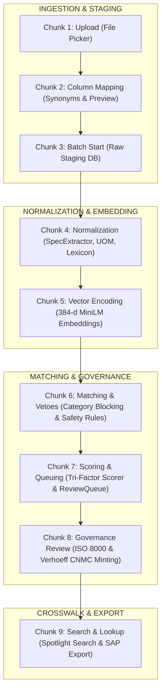

# UniMM Master Pipeline: 9-Chunk Forensic Reference Guide

> **Agent & Engineer Note:**  
> This reference manual defines the **exact 9-chunk architecture** of the National Unified Material Master (UniMM).  
> In individual chats, whenever the user says *"Let's trace Chunk X"* or *"Brutally audit Chunk X"*, load this document to retrieve the exact frontend files, backend APIs, services, database tables, data transformations, failure points, and isolation testing commands.

---

## 🗺️ Master Pipeline Index

| Chunk # | Chunk Name | What You Interact With (UI) | Behind-the-Scenes Service | Database Tables Touched |
|:---:|---|---|---|---|
| **1** | [**Upload**](#chunk-1-upload) | Ingestion Page File Picker | `POST /detect-columns` | *None* (reads stream in-memory) |
| **2** | [**Column Mapping**](#chunk-2-column-mapping) | Suggested Mappings UI | `STANDARD_HEADER_SYNONYMS` | *None* (computes preview) |
| **3** | [**Batch Start**](#chunk-3-batch-start) | "Confirm & Start Batch" Button | `POST /start-batch` | `ingestion_batches`, `raw_materials` |
| **4** | [**Normalization**](#chunk-4-normalization) | Live Status Indicator | `SpecExtractor`, `UOMNormalizer`, `DomainLexicon` | `materials`, `procurement_history` |
| **5** | [**Vector Encoding**](#chunk-5-vector-encoding) | Background Task Worker | `EmbeddingService` (`all-MiniLM-L6-v2`) | `material_embeddings` |
| **6** | [**Matching & Vetoes**](#chunk-6-matching--vetoes) | Matching Trigger Button / Job | `MatcherEngine`, `SafetyGuardrails` | *In-memory evaluation* |
| **7** | [**Scoring & Queuing**](#chunk-7-scoring--queuing) | Review Queue List | `CompositeScorer`, `ClusterEngine` | `match_candidates`, `review_queue` |
| **8** | [**Governance Review**](#chunk-8-governance-review) | 3-Way Cluster Card & "Approve" | `CNMCMinter`, `GoldenRecordService`, `CrosswalkService` | `golden_records`, `cnmc_codes`, `crosswalks`, `audit_logs` |
| **9** | [**Search & Lookup**](#chunk-9-search--lookup) | Crosswalk Spotlight Search | `GET /crosswalk/lookup`, `export/sap-lsmw-csv` | Reads `crosswalks`, `cnmc_codes`, `materials` |

---

## Complete Pipeline Sequence Flow



---

## Chunk Details

---

### <a id="chunk-1-upload"></a>🧩 Chunk 1: Upload

#### 1. Summary
The user selects a target refinery entity (**CPCL**, **IOCL**, or **BPCL**) and uploads an ERP extract file (`.csv`, `.xls`, `.xlsx`) or clicks "Load Sample". The frontend initiates the first HTTP contact with the backend to inspect file columns.

#### 2. Frontend Layer
- **Component File:** [`frontend/src/app/ingestion/page.tsx`](file:///Users/rupesh/Documents/Arc-1/frontend/src/app/ingestion/page.tsx)
- **Functions:** `handleFileChange()` (lines 51–70), `loadSample()` (lines 72–89)
- **State Hooks:** `file: File | null`, `selectedCPSE: string`, `isDetecting: boolean`
- **API Call:** `api.detectColumns(selected, selectedCPSE)` in [`frontend/src/lib/api.ts:L31-L44`](file:///Users/rupesh/Documents/Arc-1/frontend/src/lib/api.ts#L31-L44)

#### 3. Backend API Layer
- **Endpoint:** `POST /api/v1/ingestion/detect-columns`
- **Controller File:** [`backend/app/api/v1/ingestion.py:L29-L98`](file:///Users/rupesh/Documents/Arc-1/backend/app/api/v1/ingestion.py#L29-L98)
- **Request Form-Data:** `file: UploadFile`, `cpse_code: str = Form("IOCL")`
- **Response Schema:** `ColumnMappingDetectResponse` ([`backend/app/schemas/schemas.py:L27-L33`](file:///Users/rupesh/Documents/Arc-1/backend/app/schemas/schemas.py#L27-L33))

#### 4. Under-the-Hood Logic
- `contents = await file.read()` reads binary bytes into memory.
- `pd.read_csv(io.BytesIO(contents), nrows=10)` parses the top 10 rows.
- Extracts header strings: `columns = list(df.columns)`.

#### 5. Database Tables Touched
- **None.** This chunk is completely stateless. The raw bytes reside temporarily in Python RAM and are discarded after preview generation.

#### 6. Data Transformation Example
```
Input:  File "iocl_sample.csv" (binary stream)
Output: detected_columns = ["MATERIAL_NO", "ITEM_SPEC", "UNIT_OF_MEASURE", "LAST_PO_PRICE", "VENDOR_NAME", "HSN_CODE"]
```

#### 7. Audit Checklist & Known Issues
- 🚨 **Double-Upload Penalty:** The file is discarded after this step. Chunk 3 re-uploads the exact same file over the network.
- 🚨 **Memory Spike:** `await file.read()` reads the entire file into RAM, even though only 10 rows are needed.
- ⚠️ **MIME Validation:** Validates format via `filename.endswith(".csv")` rather than magic bytes.

#### 8. How to Test in Isolation
```bash
curl -s -X POST "http://localhost:8000/api/v1/ingestion/detect-columns" \
  -F "file=@samples/sample_materials.csv" \
  -F "cpse_code=IOCL" | jq .
```

#### 9. Handoff Contract
- **Input:** User file selection from OS file picker.
- **Output to Chunk 2:** `detected_columns: string[]` and raw 10-row slice for mapping analysis.

---

### <a id="chunk-2-column-mapping"></a>🧩 Chunk 2: Column Mapping

#### 1. Summary
The backend matches raw ERP header names against standard canonical attributes using fuzzy synonym dictionaries. It calculates confidence scores and computes a live 5-row normalization preview so the user can verify data health before committing.

#### 2. Frontend Layer
- **Component File:** [`frontend/src/app/ingestion/page.tsx:L152-L260`](file:///Users/rupesh/Documents/Arc-1/frontend/src/app/ingestion/page.tsx#L152-L260)
- **Functions:** `handleMappingChange(sourceCol, targetField)`
- **UI Rendered:** Suggested mapping cards, confidence badges (e.g. `98% Confidence`), and the **Live 5-Row Normalization Preview Table**.

#### 3. Backend Logic & Heuristics
- **Source File:** [`backend/app/api/v1/ingestion.py:L20-L95`](file:///Users/rupesh/Documents/Arc-1/backend/app/api/v1/ingestion.py#L20-L95)
- **Synonym Dictionary (`STANDARD_HEADER_SYNONYMS`):**
  - `material_code`: `["MATERIAL_NO", "MATNR", "ITEM_CODE", "SAP_CODE"]`
  - `short_description`: `["ITEM_SPEC", "DESCRIPTION", "SHORT_DESC", "MAKTX"]`
  - `uom`: `["UNIT_OF_MEASURE", "UOM", "MEINS", "UNIT"]`
  - `base_price`: `["LAST_PO_PRICE", "PRICE", "NETPR", "RATE"]`
  - `vendor_name`: `["VENDOR_NAME", "VENDOR", "NAME1", "SUPPLIER"]`
  - `hsn_code`: `["HSN_CODE", "HSN", "SAC", "TARIFF_CODE"]`
- **Preview Generation:** Runs `SpecExtractor.extract_specs()` and `UOMNormalizer.extract_packaging_factor()` across rows 0–4.

#### 4. Database Tables Touched
- **None.** Previews are synthesized entirely in memory.

#### 5. Data Transformation Example
```json
// Raw Header: "ITEM_SPEC" -> Target: "short_description" (Confidence: 0.98)
// Raw Header: "MEINS"     -> Target: "uom"               (Confidence: 0.98)
// Live Preview Row 1:
{
  "ITEM_SPEC": "VALVE, GATE, 150MM, CL300, WCB",
  "_preview_normalized_desc": "VALVE, GATE, 6 INCH (150 MM), CLASS 300#, WCB",
  "_preview_uom": "EA"
}
```

#### 6. Audit Checklist & Known Issues
- ⚠️ If a header does not match known synonyms, it defaults to `"unmapped"` with 50% confidence.
- ⚠️ If the user overrides a suggested mapping in the UI, verify that `mappingConfig` updates immediately in React state before starting the batch.

#### 7. How to Test in Isolation
```python
# In python terminal / pytest:
from app.api.v1.ingestion import STANDARD_HEADER_SYNONYMS
col = "MAKTX"
assert any(col in syns for syns in STANDARD_HEADER_SYNONYMS.values())
```

#### 8. Handoff Contract
- **Input from Chunk 1:** Raw column names and first 10 rows.
- **Output to Chunk 3:** Approved column mapping dictionary (e.g. `{"ITEM_SPEC": "short_description", "MATERIAL_NO": "material_code"}`).

---

### <a id="chunk-3-batch-start"></a>🧩 Chunk 3: Batch Start

#### 1. Summary
The user clicks **"Confirm & Start Ingestion Batch"**. The file and mapping configuration are submitted to the backend. The backend creates an `IngestionBatch` record, stores every unaltered row in the `raw_materials` table as raw JSON (Lakehouse Bronze Layer), and dispatches the batch for processing.

#### 2. Frontend Layer
- **Component File:** [`frontend/src/app/ingestion/page.tsx:L98-L111`](file:///Users/rupesh/Documents/Arc-1/frontend/src/app/ingestion/page.tsx#L98-L111)
- **Function:** `handleStartBatch()`
- **State Hooks:** `isStartingBatch: boolean`, `batchResult: any`
- **API Call:** `api.startBatch(file, selectedCPSE, JSON.stringify(mappingConfig))` in [`frontend/src/lib/api.ts:L45-L59`](file:///Users/rupesh/Documents/Arc-1/frontend/src/lib/api.ts#L45-L59)

#### 3. Backend API Layer
- **Endpoint:** `POST /api/v1/ingestion/start-batch`
- **Controller File:** [`backend/app/api/v1/ingestion.py:L100-L178`](file:///Users/rupesh/Documents/Arc-1/backend/app/api/v1/ingestion.py#L100-L178)
- **Parameters:** `file: UploadFile`, `cpse_code: str`, `mapping_config_json: str`
- **Auth Dependency:** `current_user: TokenData = Depends(get_current_user)`
- **Response Schema:** `IngestionBatchResponse` ([`backend/app/schemas/schemas.py:L15-L25`](file:///Users/rupesh/Documents/Arc-1/backend/app/schemas/schemas.py#L15-L25))

#### 4. Database Tables Touched
1. **`ingestion_batches`** ([`backend/app/models/models.py:L57-L70`](file:///Users/rupesh/Documents/Arc-1/backend/app/models/models.py#L57-L70)):
   - Inserts: `cpse_id`, `file_name`, `file_size_bytes`, `total_rows`, `processed_rows=0`, `status="PENDING"`.
2. **`raw_materials`** ([`backend/app/models/models.py:L72-L80`](file:///Users/rupesh/Documents/Arc-1/backend/app/models/models.py#L72-L80)):
   - Inserts row-by-row: `batch_id`, `cpse_id`, `row_index`, `raw_data: JSONB`.

#### 5. Data Transformation Example
```sql
-- Raw row inserted into raw_materials:
INSERT INTO raw_materials (batch_id, cpse_id, row_index, raw_data)
VALUES (1, 2, 0, '{"MATERIAL_NO": "889102", "ITEM_SPEC": "VALVE, GATE, 150MM, CL300, WCB", "UNIT_OF_MEASURE": "EA", "LAST_PO_PRICE": "10800.0"}');
```

#### 6. Audit Checklist & Known Issues
- 🚨 **Fake Celery Call:** Line 156 calls `process_ingestion_batch_task(batch.id, inv_map)` directly as a synchronous function instead of `.delay()`, blocking the HTTP thread!
- 🚨 **Iterrows Slowdown:** `df.iterrows()` iterates row-by-row in Python rather than performing bulk inserts.

#### 7. How to Test in Isolation
```bash
curl -s -X POST "http://localhost:8000/api/v1/ingestion/start-batch" \
  -F "file=@samples/sample_materials.csv" \
  -F "cpse_code=IOCL" \
  -F 'mapping_config_json={"MATERIAL_NO":"material_code","ITEM_SPEC":"short_description","UNIT_OF_MEASURE":"uom","LAST_PO_PRICE":"base_price"}' | jq .
```

#### 8. Handoff Contract
- **Input from Chunk 2:** Approved column mapping JSON + file.
- **Output to Chunk 4:** Stored `batch_id` with records staged in `raw_materials`.

---

### <a id="chunk-4-normalization"></a>🧩 Chunk 4: Normalization

#### 1. Summary
The ingestion engine reads staged `raw_materials` rows and runs deterministic domain normalization: translates Indian plant slang, normalizes ASME/ANSI standards, extracts engineering specifications via parametric regex, standardizes UOMs, and computes packaging multipliers.

#### 2. Worker & Service Files
- **Task Worker:** [`backend/app/tasks/ingestion_tasks.py:L13-L122`](file:///Users/rupesh/Documents/Arc-1/backend/app/tasks/ingestion_tasks.py#L13-L122) (`process_ingestion_batch_task`)
- **Lexicon Service:** [`backend/app/services/normalization/domain_lexicon.py`](file:///Users/rupesh/Documents/Arc-1/backend/app/services/normalization/domain_lexicon.py)
- **Spec Extractor:** [`backend/app/services/normalization/spec_extractor.py`](file:///Users/rupesh/Documents/Arc-1/backend/app/services/normalization/spec_extractor.py)
- **UOM Normalizer:** [`backend/app/services/normalization/uom_normalizer.py`](file:///Users/rupesh/Documents/Arc-1/backend/app/services/normalization/uom_normalizer.py)
- **Vendor Normalizer:** [`backend/app/services/normalization/vendor_normalizer.py`](file:///Users/rupesh/Documents/Arc-1/backend/app/services/normalization/vendor_normalizer.py)

#### 3. Under-the-Hood Logic
1. **Hinglish & Industry Standards:** `DomainLexicon` translates terms like `jaali wala` $\rightarrow$ `SPIRAL WOUND`, `churi` $\rightarrow$ `THREADED`, and unifies `ANSI B16.5` $\equiv$ `ASME B16.5`.
2. **Parametric Spec Extraction (`SpecExtractor`):**
   - **Nominal Size:** Converts `150MM`, `6"`, `6IN` $\rightarrow$ `6 INCH (150 MM)`.
   - **Pressure Class:** Extracts `150#`, `300#`, `CL300`, `CLASS 300` $\rightarrow$ `CLASS 300#`.
   - **Schedule:** Extracts `SCH 40`, `SCH 80`, `SCH 160`.
   - **MOC (Metallurgy):** Standardizes `WCB`, `CS`, `A106`, `A105`, `SS316`.
   - **OEM Bearing Part Numbers:** Extracts `6205-2RS1/C3` $\rightarrow$ Part: `6205-2RS1`, Clearance: `C3`.
3. **Packaging Multipliers (`UOMNormalizer`):**
   - If description has `18KG BUCKET` and UOM is `BKT`, it sets `package_multiplier = 18.0` and `base_uom = "KG"`.

#### 4. Database Tables Touched
1. **`materials`** ([`backend/app/models/models.py:L82-L148`](file:///Users/rupesh/Documents/Arc-1/backend/app/models/models.py#L82-L148)):
   - Inserts clean record: `item_noun`, `nominal_size`, `pressure_class`, `moc`, `schedule`, `end_connection`, `standard_spec`, `part_number`, `clean_part_number`, `clearance_suffix`, `is_kit_or_assembly`, `base_uom`, `package_multiplier`, `extracted_attributes: JSONB`.
2. **`procurement_history`** ([`backend/app/models/models.py:L161-L182`](file:///Users/rupesh/Documents/Arc-1/backend/app/models/models.py#L161-L182)):
   - Inserts: `vendor_name`, `vendor_normalized`, `unit_price`, `hsn_code`, `quantity`, `total_spend`.

#### 5. Data Transformation Example
```
Input Raw:   "VALVE, GATE, 150MM, CL300, WCB", UOM="EA", Vendor="Larsen & Toubro Ltd - Valve Div"
Output DB:   item_noun        = "VALVE, GATE"
             nominal_size     = "6 INCH (150 MM)"
             pressure_class   = "CLASS 300#"
             moc              = "ASTM A216 WCB"
             vendor_normalized= "LARSEN & TOUBRO"
             base_uom         = "EA"
```

#### 6. Audit Checklist & Known Issues
- ⚠️ Verify inch-to-mm conversions in `INCH_MM_MAP`: Ensure `DN150` and `150MM` both map to `6 INCH (150 MM)`.
- ⚠️ Check bearing suffix regex: Ensure `/C3` or `2RS1` suffixes do not get stripped into meaningless tokens.

#### 7. How to Test in Isolation
```bash
pytest backend/tests/test_spec_extractor.py -v
pytest backend/tests/test_uom_normalizer.py -v
```

#### 8. Handoff Contract
- **Input from Chunk 3:** Raw string data in `raw_materials`.
- **Output to Chunk 5:** Clean, structured entity in `materials` table ready for vectorization.

---

### <a id="chunk-5-vector-encoding"></a>🧩 Chunk 5: Vector Encoding & Neural Embeddings

#### 1. Summary
Each normalized material description is transformed into a dense vector embedding using `BAAI/bge-base-en-v1.5` (768-dimensional) or the lightweight fallback `all-MiniLM-L6-v2` (384-dimensional). The dense representation is paired with learned sparse BM25 vectors for exact keyword matching, and borderline candidate clusters can be scored via a neural Cross-Encoder (`cross-encoder/ms-marco-MiniLM-L-6-v2`). The dense vectors are stored in PostgreSQL using the `pgvector` extension for semantic HNSW indexing.

#### 2. Service Layer
- **File:** [`backend/app/services/matching/embeddings.py`](file:///Users/rupesh/Documents/Arc-1/backend/app/services/matching/embeddings.py)
- **Primary Model:** `BAAI/bge-base-en-v1.5` (768-dim, top-tier MTEB retrieval performance)
- **Fallback Model:** `sentence-transformers/all-MiniLM-L6-v2` (384-dim, lightweight edge deployment)
- **Neural Reranker:** `cross-encoder/ms-marco-MiniLM-L-6-v2` (deep bidirectional pair cross-attention)
- **Sparse Encoder:** `rank_bm25.BM25Okapi` (exact keyword and OEM part number preservation)
- **Hardware Acceleration:** Auto-detected via `get_inference_device()`: Apple Silicon MPS (`mps`), NVIDIA CUDA (`cuda`), or CPU fallback (`cpu`).
- **Methods:**
  - `EmbeddingService.generate_embedding(text: str) -> List[float]`
  - `EmbeddingService.generate_sparse_vector(text: str) -> Dict[str, float]`
  - `EmbeddingService.rerank_pair(desc_a: str, desc_b: str) -> float`

#### 3. Under-the-Hood Logic
- Builds high-signal canonical text using `EmbeddingService.build_canonical_text(specs, raw_desc)`.
- Passes canonical string to `SentenceTransformer.encode(text, convert_to_numpy=True)`.
- Normalizes dense vector to unit length ($L_2$ norm) so that cosine similarity can be computed via inner product.
- Tokenizes words with engineering punctuation preservation to generate learned BM25 sparse keyword representations.

#### 4. Database Tables Touched
- **`material_embeddings`** ([`backend/app/models/models.py:L150-L165`](file:///Users/rupesh/Documents/Arc-1/backend/app/models/models.py#L150-L165)):
  - Column: `embedding: Vector(768)` or `Vector(384)` (pgvector column type).
  - Column: `sparse_vector: JSON` (learned sparse dictionary representations).
  - Column: `model_name: String` (records exact model used, e.g. `BAAI/bge-base-en-v1.5`).
  - Foreign key: `material_id -> materials.id`.

#### 5. Data Transformation Example
```
Input Specs:   {"item_noun": "VALVE, GATE", "nominal_size": "6 INCH (150 MM)", "pressure_class": "CLASS 300#", "moc": "ASTM A216 WCB"}
Canonical Text: "VALVE, GATE, 6 INCH (150 MM), CLASS 300#, ASTM A216 WCB"
Output Vector: [0.0312, -0.0541, 0.0892, 0.0118, ..., -0.0245]  (768 float32 dimensions)
Sparse Tokens: {"valve": 0.42, "gate": 0.51, "6in": 0.88, "300#": 0.94, "wcb": 0.92}
```

#### 6. Audit Checklist & Known Issues
- 🚨 **Hardware Acceleration:** Ensure `mps` (macOS Apple Silicon) or `cuda` (Linux GPU) is active for sub-5ms inference.
- ⚠️ Ensure PostgreSQL has the `vector` extension enabled (`CREATE EXTENSION IF NOT EXISTS vector;`).
- ⚠️ Dimension alignment: Database vector column and model embedding dimension must match (`768` for BGE, `384` for MiniLM).

#### 7. How to Test in Isolation
```python
# In python terminal:
from app.services.matching.embeddings import EmbeddingService
v = EmbeddingService.generate_embedding("VALVE GATE 6IN 300#")
assert len(v) in (384, 768)
```

#### 8. Handoff Contract
- **Input from Chunk 4:** Standardized `short_description` and `extracted_attributes` on `Material`.
- **Output to Chunk 6:** Persisted dense + sparse vectors in `material_embeddings` table.

---

### <a id="chunk-6-matching--vetoes"></a>🧩 Chunk 6: Matching & Vetoes

#### 1. Summary
The cross-CPSE matching engine triggers cross-refinery comparisons. To prevent an $N \times N$ computational explosion, it uses **Level-1 Category / Noun Blocking**. Before running any AI scoring, it evaluates **Hard Deterministic Invariant Safety Guardrail Rules**. If physical parameters conflict, the merge is vetoed.

#### 2. Engine & Guardrail Files
- **Matching Controller:** [`backend/app/api/v1/matching.py:L12-L37`](file:///Users/rupesh/Documents/Arc-1/backend/app/api/v1/matching.py#L12-L37)
- **Matcher Engine:** [`backend/app/services/matching/matcher_engine.py:L15-L105`](file:///Users/rupesh/Documents/Arc-1/backend/app/services/matching/matcher_engine.py#L15-L105)
- **Guardrails Engine:** [`backend/app/services/matching/guardrails.py`](file:///Users/rupesh/Documents/Arc-1/backend/app/services/matching/guardrails.py)

#### 3. Under-the-Hood Logic & Invariant Vetoes
1. **Blocking:** Materials are partitioned into candidate blocks by item noun (`NOUN_VALVE, GATE`) or clean part prefix (`PART_6205`). Only pairs from **different CPSEs** within the same block are evaluated.
2. **Hard Deterministic Safety Guardrail Rules (`SafetyGuardrails.evaluate_pair`):**
   - **Wall Thickness Conflict:** e.g. 4" Pipe `SCH 40` vs `SCH 80` $\rightarrow$ **HARD VETO** (`veto_reason = "Wall thickness schedule mismatch"`).
   - **Pressure Class Conflict:** e.g. 2" Valve `150#` vs `300#` $\rightarrow$ **HARD VETO** (`veto_reason = "Pressure rating conflict"`).
   - **Assembly vs Component Spare:** e.g. Mechanical Seal Kit vs Seal Ring $\rightarrow$ **HARD VETO** (`veto_reason = "Assembly kit cannot merge with spare component"`).
   - **Bearing Clearance Modifier:** e.g. Standard vs `/C3` clearance $\rightarrow$ Routed to **SUBSTITUTE** instead of identical.

#### 4. Database Tables Touched
- Reads from `materials`, `material_embeddings`, and `procurement_history`. All blocking and veto evaluations run in-memory.

#### 5. Data Transformation Example
```
Pair Tested: CPCL "PIPE CS 4" SCH 40" vs IOCL "PIPE CS 4" SCH 80"
Guardrail:   is_vetoed = True
             veto_reason = "Wall thickness schedule mismatch: SCH 40 vs SCH 80"
             suggested_route = "SUBSTITUTE" (or REJECT)
```

#### 6. Audit Checklist & Known Issues
- ⚠️ Ensure that AI semantic similarity NEVER overrides a safety veto. Even if semantic similarity is 0.99, a pressure or wall thickness mismatch must trigger a veto.

#### 7. How to Test in Isolation
```bash
pytest backend/tests/test_guardrails.py -v
```

#### 8. Handoff Contract
- **Input from Chunk 5:** Active materials with their embeddings and extracted specs.
- **Output to Chunk 7:** Veto status (`is_vetoed`, `veto_reason`) passed to the scoring engine.

---

### <a id="chunk-7-scoring--queuing"></a>🧩 Chunk 7: Scoring & Queuing

#### 1. Summary
For candidate pairs, the engine calculates a transparent, formula-based **Composite Score** combining semantic similarity, attribute overlap, and procurement correlation. Candidate pairs are grouped into coherent clusters and inserted into the **Review Queue** for human validation.

#### 2. Engine & Scorer Files
- **Scorer Service:** [`backend/app/services/matching/scorer.py`](file:///Users/rupesh/Documents/Arc-1/backend/app/services/matching/scorer.py)
- **Cluster Engine:** [`backend/app/services/matching/cluster_engine.py`](file:///Users/rupesh/Documents/Arc-1/backend/app/services/matching/cluster_engine.py)
- **Matcher Engine:** [`backend/app/services/matching/matcher_engine.py:L106-L165`](file:///Users/rupesh/Documents/Arc-1/backend/app/services/matching/matcher_engine.py#L106-L165)

#### 3. Mathematical Formula & Scoring Logic
$$\text{Composite Score} = 0.40 \times S_{\text{sem}} + 0.35 \times S_{\text{attr}} + 0.25 \times S_{\text{proc}}$$
- **$S_{\text{sem}}$ (Cosine Semantic Similarity):** Dot product of unit-normalized 384-d vectors.
- **$S_{\text{attr}}$ (Attribute Overlap Score):** Jaccard overlap of extracted specs (nominal size, pressure class, schedule, MOC, end connection).
- **$S_{\text{proc}}$ (Procurement Score):** Price ratio proximity ($\min / \max$), vendor normalized match, HSN code match.
- **Adaptive Rebalancing:** If procurement data is missing, the 0.25 weight is dynamically redistributed proportionally to semantic and attribute signals so identical items are not unfairly penalized.
- **Cluster Grouping:** Materials sharing the canonical spec signature are clustered under a `cluster_group_id`.

#### 4. Database Tables Touched
1. **`match_jobs`** ([`backend/app/models/models.py:L184-L197`](file:///Users/rupesh/Documents/Arc-1/backend/app/models/models.py#L184-L197)):
   - Tracks job status (`RUNNING` $\rightarrow$ `COMPLETED`), `total_pairs_evaluated`, `candidates_found`.
2. **`match_candidates`** ([`backend/app/models/models.py:L199-L224`](file:///Users/rupesh/Documents/Arc-1/backend/app/models/models.py#L199-L224)):
   - Stores candidate pairs: `material_a_id`, `material_b_id`, `semantic_score`, `attribute_score`, `procurement_score`, `composite_score`, `safety_veto`, `veto_reason`, `confidence_tier`, `cluster_group_id`.
3. **`review_queue`** ([`backend/app/models/models.py:L226-L245`](file:///Users/rupesh/Documents/Arc-1/backend/app/models/models.py#L226-L245)):
   - Enqueues clusters requiring human validation: `candidate_id`, `cluster_group_id`, `category_code`, `status="PENDING"`, `confidence_tier`.

#### 5. Data Transformation Example
```
CPCL 6" 300# Gate Valve vs IOCL 150MM CL300 Gate Valve:
S_sem  = 0.94
S_attr = 1.00
S_proc = 0.86  (Vendor match: L&T, Price: 12500 vs 10800)
Composite = 0.40(0.94) + 0.35(1.00) + 0.25(0.86) = 0.941
Confidence Tier = "HIGH"
Cluster Group ID = "cluster_4f9a2b1c" -> Enqueued in review_queue
```

#### 6. Audit Checklist & Known Issues
- ⚠️ If an item was vetoed by safety guardrails, verify that `composite_score = 0.0` or `confidence_tier = "LOW"`, forcing explicit human sign-off.
- ⚠️ Verify edge density gating in `ClusterEngine`: Prevents transitive chaining (e.g. 2" reducer matching 3" pipe, collapsing all sizes).

#### 7. How to Test in Isolation
```bash
pytest backend/tests/test_scorer.py -v
```

#### 8. Handoff Contract
- **Input from Chunk 6:** Guardrail evaluated candidate pairs.
- **Output to Chunk 8:** `review_queue` records ready for human review.

---

### <a id="chunk-8-governance-review"></a>🧩 Chunk 8: Governance Review & Cryptographic Audit

#### 1. Summary
A human procurement officer or data steward opens the **Governance Review Queue** (`/review`). They inspect multi-CPSE candidate clusters across 4 status tabs (`PENDING`, `DISPUTED`, `APPROVED`, `REJECTED`), check score math, inspect safety badges, and record one of the **7 Approved Relationships** (`IDENTICAL`, `FUNCTIONAL_EQUIVALENT`, `BRAND_ALTERNATIVE`, `KIT_COMPONENT`, `PACKAGING_VARIANT`, `SUPERSEDED`, `SUBSTITUTE`) or raise a multi-CPSE dispute. The backend synthesizes an ISO 8000 description, atomically mints a **Verhoeff-checksummed National Code (`CNMC-XXXXXXXX-C`)**, writes N:1 crosswalk links, appends an HMAC-SHA256 chained audit record, and persists training telemetry in `review_feedback`.

#### 2. Frontend Layer
- **Component File:** [`frontend/src/app/review/page.tsx`](file:///Users/rupesh/Documents/Arc-1/frontend/src/app/review/page.tsx)
- **Functions:** `loadQueue()`, `loadClusterDetails(clusterId)`, `handleAction(decisionType)`, `handleDisputeSubmit()`
- **UI Elements:** Status filter tabs (`PENDING`, `DISPUTED`, `APPROVED`, `REJECTED`), multi-CPSE comparison cards, score breakdown modal, ISO 8000 editable input, 7-relationship action selectors, In-App Dispute Arbitration Modal.
- **API Calls:**
  - `api.executeReviewAction(...)` in [`frontend/src/lib/api.ts`](file:///Users/rupesh/Documents/Arc-1/frontend/src/lib/api.ts)
  - `api.raiseDispute(...)` in [`frontend/src/lib/api.ts`](file:///Users/rupesh/Documents/Arc-1/frontend/src/lib/api.ts)

#### 3. Backend API & Governance Services
- **Action Endpoint:** `POST /api/v1/review/action`
- **Dispute Endpoint:** `POST /api/v1/review/dispute`
- **Feedback Export:** `GET /api/v1/review/feedback/export`
- **Audit Endpoints:** `GET /api/v1/audit/logs`, `GET /api/v1/audit/verify-chain`
- **Controller Files:**
  - [`backend/app/api/v1/review.py`](file:///Users/rupesh/Documents/Arc-1/backend/app/api/v1/review.py)
  - [`backend/app/api/v1/audit.py`](file:///Users/rupesh/Documents/Arc-1/backend/app/api/v1/audit.py)
- **Services Involved:**
  - **ISO 8000 Synthesizer:** [`GoldenRecordService`](file:///Users/rupesh/Documents/Arc-1/backend/app/services/governance/golden_record_service.py)
  - **National Code Minter:** [`CNMCMinter`](file:///Users/rupesh/Documents/Arc-1/backend/app/services/governance/cnmc_minter.py) (implements Verhoeff Checksum Algorithm)
  - **Crosswalk Hub:** [`CrosswalkService`](file:///Users/rupesh/Documents/Arc-1/backend/app/services/governance/crosswalk_service.py)
  - **Audit Service:** [`AuditService`](file:///Users/rupesh/Documents/Arc-1/backend/app/services/governance/audit_service.py) (HMAC-SHA256 cryptographic chaining & verification)

#### 4. Database Tables Touched
1. **`golden_records`** ([`backend/app/models/models.py:L268-L295`](file:///Users/rupesh/Documents/Arc-1/backend/app/models/models.py#L268-L295)):
   - Inserts: `standardized_description`, `item_noun`, `nominal_size`, `pressure_class`, `moc`, `canonical_attributes: JSONB`.
2. **`cnmc_codes`** ([`backend/app/models/models.py:L247-L266`](file:///Users/rupesh/Documents/Arc-1/backend/app/models/models.py#L247-L266)):
   - Inserts authoritative code: e.g. `code = "CNMC-00000001-7"`, `golden_record_id`, `status="ACTIVE"`.
3. **`crosswalks`** ([`backend/app/models/models.py:L297-L321`](file:///Users/rupesh/Documents/Arc-1/backend/app/models/models.py#L297-L321)):
   - Writes N:1 mapping rows linking each local CPSE material ID to the new `cnmc_code_id`.
4. **`review_feedback`** ([`backend/app/models/models.py:L361-L380`](file:///Users/rupesh/Documents/Arc-1/backend/app/models/models.py#L361-L380)):
   - Stores labeled human decisions, feature vectors, and reviewer notes for active learning model calibration.
5. **`audit_logs`** ([`backend/app/models/models.py:L323-L345`](file:///Users/rupesh/Documents/Arc-1/backend/app/models/models.py#L323-L345)):
   - Appends immutable audit entry with `signature` and `prev_signature`.
6. **`review_queue`**:
   - Updates: `status = "APPROVED"`, `decision_type = "IDENTICAL"`, or `status = "DISPUTED"`.

#### 5. Data Transformation Example
```
Action:      User approves cluster with CPCL (100234), IOCL (889102), BPCL (445511)
Decision:    IDENTICAL (or FUNCTIONAL_EQUIVALENT, BRAND_ALTERNATIVE, etc.)
ISO 8000:    "VALVE, GATE, 6 INCH (150 MM), CLASS 300#, FLANGED RF, ASTM A216 WCB"
Minted Code: "CNMC-00000001-7" (Last digit '7' is the Verhoeff checksum)
Crosswalk:   CPCL:100234 -> CNMC-00000001-7
             IOCL:889102 -> CNMC-00000001-7
             BPCL:445511 -> CNMC-00000001-7
Feedback:    Saved pair telemetry vector to ReviewFeedback
```

#### 6. Audit Checklist & Known Issues
- ⚠️ Verify Verhoeff Checksum: Code format must be `CNMC-XXXXXXXX-C`. Single-digit typos or transpositions must be rejected.
- ⚠️ Verify Audit Chain: Run `GET /api/v1/audit/verify-chain` to ensure chain continuity and zero tampering across all entries.
- ⚠️ Bulk Approval Invariant: Ensure candidates with `safety_veto == True` are skipped during bulk operations.

#### 7. How to Test in Isolation
```bash
pytest backend/tests/test_audit_precision_upgrades.py -v
pytest backend/tests/test_chunk8_governance.py -v
```

#### 8. Handoff Contract
- **Input from Chunk 7:** Cluster ID in `review_queue`.
- **Output to Chunk 9:** Minted `CNMCCode` and active mappings in `crosswalks`.

---

### <a id="chunk-9-search--lookup"></a>🧩 Chunk 9: Search, Lookup & ERP Syndication

#### 1. Summary
End users (plant engineers, procurement officers) and external enterprise systems (SAP S/4HANA, GeM) query the platform. The Crosswalk Hub loads the complete National Crosswalk Registry on mount, provides spotlight search by local ERP code, and exposes instant one-click enterprise syndication: **Syndicate to GeM**, **Export SAP MATMAS05 IDoc**, and **Verify Cryptographic Audit Chain**.

#### 2. Frontend Layer
- **Component File:** [`frontend/src/app/crosswalk/page.tsx`](file:///Users/rupesh/Documents/Arc-1/frontend/src/app/crosswalk/page.tsx)
- **Functions:** `loadRegistry()`, `handleSearch()`, `handleSyncGeM()`, `handleExportIDoc()`, `handleVerifyAudit()`
- **UI Elements:** National Master Registry Table, Spotlight search input, refinery filter, GeM syndicate button, SAP IDoc export button, Verify Audit Chain badge.
- **API Calls:**
  - `api.getCrosswalkRegistry()`
  - `api.reverseLookup(localCode, cpseCode)`
  - `api.syncGeMCatalog(cnmcCode)`
  - `api.exportSapIDoc(cnmcCode)`
  - `api.verifyAuditChain()`

#### 3. Backend API & Export Services
- **Lookup Endpoint:** `GET /api/v1/crosswalk/lookup?local_code={code}`
- **Export Endpoint:** `GET /api/v1/export/sap-lsmw-csv`
- **Controller Files:**
  - [`backend/app/api/v1/crosswalk.py`](file:///Users/rupesh/Documents/Arc-1/backend/app/api/v1/crosswalk.py)
  - [`backend/app/api/v1/export.py`](file:///Users/rupesh/Documents/Arc-1/backend/app/api/v1/export.py)
- **SAP Integration:** [`backend/app/services/export/sap_export.py`](file:///Users/rupesh/Documents/Arc-1/backend/app/services/export/sap_export.py), [`backend/app/api/v1/integration/sap.py`](file:///Users/rupesh/Documents/Arc-1/backend/app/api/v1/integration/sap.py)

#### 4. Database Tables Touched
- Queries `crosswalks`, joins with `cnmc_codes`, `golden_records`, `materials`, and `cpse`. (Pure read operation).

#### 5. Data Transformation Example
```json
// Query: GET /crosswalk/lookup?local_code=889102 (IOCL Code)
// Response:
{
  "searched_code": "889102",
  "cpse_code": "IOCL",
  "cnmc_code": "CNMC-00000001-7",
  "standardized_description": "VALVE, GATE, 6 INCH (150 MM), CLASS 300#, FLANGED RF, ASTM A216 WCB",
  "sister_mappings": [
    { "cpse": "CPCL", "material_code": "100234", "mapping_type": "IDENTICAL" },
    { "cpse": "BPCL", "material_code": "445511", "mapping_type": "IDENTICAL" }
  ]
}
```

#### 6. Audit Checklist & Known Issues
- ⚠️ Verify sub-10ms response time on `/crosswalk/lookup`: Queries should use indexed lookups on `crosswalks.local_material_code`.
- ⚠️ Verify SAP LSMW CSV export headers: Header must conform to SAP ECC / S/4HANA migration formats (`CNMC_CODE`, `LOCAL_MATERIAL_NO`, `MAKTX_ISO8000`, `MEINS`).

#### 7. How to Test in Isolation
```bash
curl -s "http://localhost:8000/api/v1/crosswalk/lookup?local_code=889102" | jq .
curl -s "http://localhost:8000/api/v1/export/sap-lsmw-csv" | head -n 5
```

#### 8. Handoff Contract
- **Input from Chunk 8:** Active crosswalk mappings in PostgreSQL.
- **Final Output:** Sub-second code resolution for plant users and ERP synchronization files.
