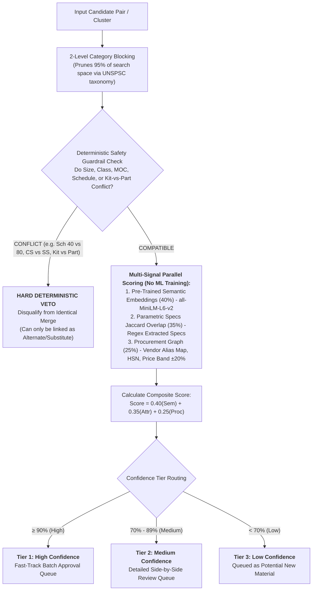
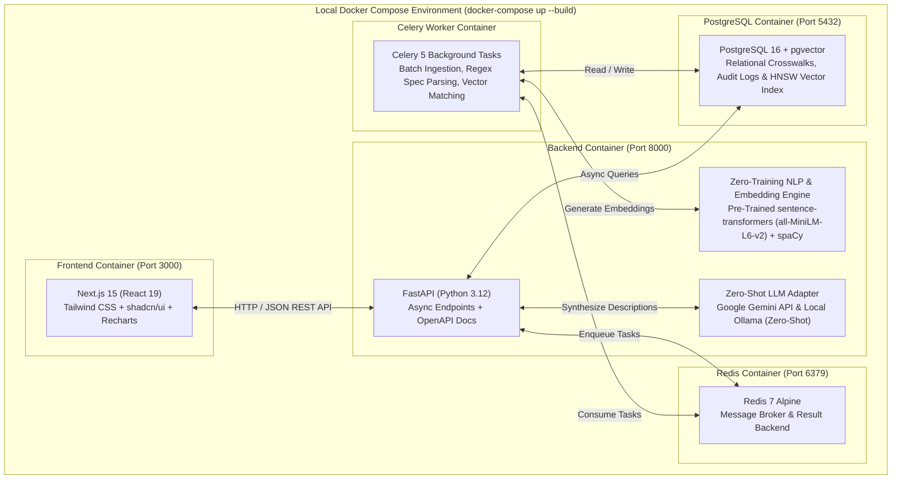
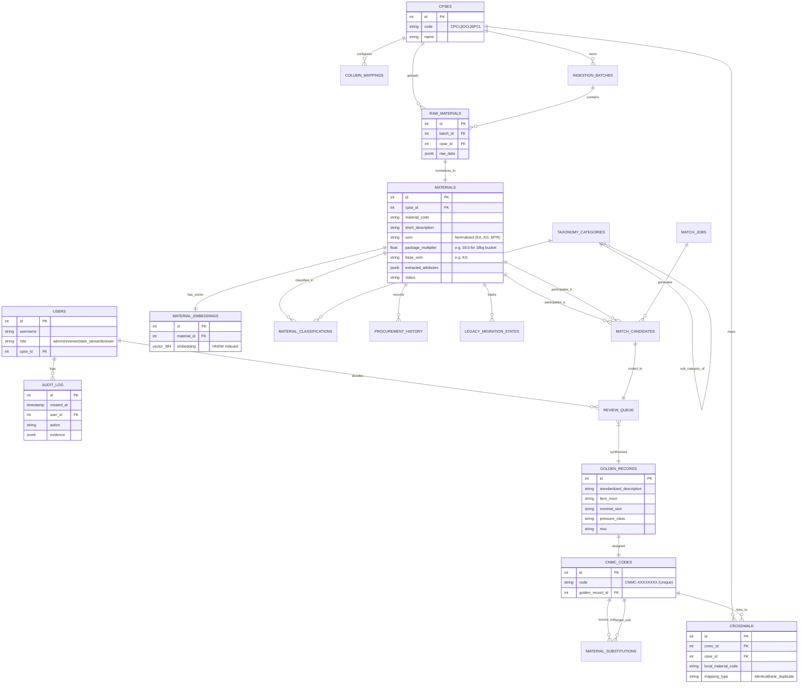
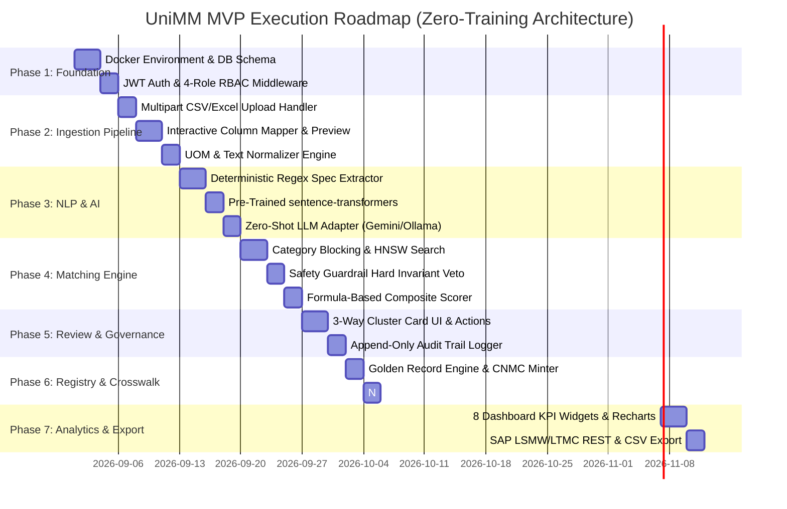

# National Unified Material Master Framework (UniMM)
## System Implementation & Visual Architecture Specification (v0.1)
**"One Nation — One Material Code" (Enterprise Scope: CPCL, IOCL, BPCL)**
**Zero-Training Architecture: Pre-Trained Zero-Shot AI + Deterministic Engineering Logic (No ML Training / Fine-Tuning Required)**

---

## Table of Contents
1. [Executive Summary & Core Architectural Constraint](#1-executive-summary--core-architectural-constraint)
2. [End-to-End Visual System Architecture](#2-end-to-end-visual-system-architecture)
3. [The 3-to-1 Unification Journey (Step-by-Step Data Flow)](#3-the-3-to-1-unification-journey-step-by-step-data-flow)
4. [Zero-Training Neuro-Symbolic Matching Engine](#4-zero-training-neuro-symbolic-matching-engine)
5. [Real-World Stress-Testing Scenarios & Safety Guardrails](#5-real-world-stress-testing-scenarios--safety-guardrails)
6. [Core Upgrades (Zero-Training Implementations)](#6-core-upgrades-zero-training-implementations)
7. [Technology Stack & Local Docker Topology](#7-technology-stack--local-docker-topology)
8. [Entity Relationship Diagram (ERD — 17 Tables)](#8-entity-relationship-diagram-erd--17-tables)
9. [Interactive UI Wireframes](#9-interactive-ui-wireframes)
10. [Executive Analytics & Demand Aggregation Dashboard](#10-executive-analytics--demand-aggregation-dashboard)
11. [Phased Vertical Slice Implementation Roadmap](#11-phased-vertical-slice-implementation-roadmap)
12. [Local Run & Verification Commands](#12-local-run--verification-commands)

---

## 1. Executive Summary & Core Architectural Constraint

Central Public Sector Enterprises (CPSEs) in the Indian Oil & Gas sector (**CPCL**, **IOCL**, and **BPCL**) require a reliable, production-grade material harmonization platform. 

```
┌─────────────────────────────────────────────────────────────────────────────────────────────────────────┐
│                                    ZERO ML TRAINING / FINE-TUNING PRINCIPLE                             │
│                                                                                                         │
│  ❌ NO Model Training Pipelines          ✅ Pre-Trained Out-of-the-Box Embeddings (all-MiniLM-L6-v2)    │
│  ❌ NO Gradient Descent / Fine-Tuning    ✅ Deterministic Regex & Parametric Engineering Tokenizers     │
│  ❌ NO Labeled Training Data Overhead    ✅ Hard Invariant Safety Guardrail Rules (Refinery Safety)     │
│  ❌ NO Black-Box Weights / Drift         ✅ 100% Transparent, Explainable Formula-Based Scoring         │
└─────────────────────────────────────────────────────────────────────────────────────────────────────────┘
```

### Strategic Outcomes:
- **Zero Training Barrier**: Runs immediately out-of-the-box on CPU/GPU without needing labeled training datasets or costly fine-tuning cycles.
- **100% Explainable & Auditable**: Every match score, guardrail veto, and classification is backed by transparent deterministic logic and vector distance math.
- **One Nation — One Material Code**: Generates a single **Common National Material Code (`CNMC-XXXXXXXX`)** while preserving local CPCL, IOCL, and BPCL mappings.
- **Demand Aggregation & ROI**: Merges multi-CPSE volumes to eliminate price discrepancies and calculate bulk procurement savings.

---

## 2. End-to-End Visual System Architecture

```mermaid
graph TB
    subgraph S1["1. Source Systems (CPSE SAP Extracts)"]
        CPCL["<b>CPCL SAP Extract</b><br/>Code: 100234<br/>'VLV GATE 6IN 300# CS FLG'<br/>Unit: Nos | Price: ₹12,500"]
        IOCL["<b>IOCL SAP Extract</b><br/>Code: 889102<br/>'VALVE, GATE, 150MM, CL300, WCB'<br/>Unit: EA | Price: ₹10,800"]
        BPCL["<b>BPCL SAP Extract</b><br/>Code: 445511<br/>'6 INCH GATE VALVE FLANGED 300#'<br/>Unit: Numbers | Price: ₹11,200"]
    end

    subgraph S2["2. Common Material Platform"]
        INGEST["<b>Batch Ingestion Layer</b><br/>Raw Data Archival (raw_materials)"]
        MAPPER["<b>Interactive Column Mapper</b><br/>Auto-Detect Headers + 5-Row Live Preview"]
        NORM["<b>Universal Normalization</b><br/>UOM Standardizer (to 'EA') + Packaging Multipliers"]
        NLP["<b>Parametric Spec Extractor</b><br/>Regex & Rules: Size, Rating, MOC, Standards<br/>Part Number Canonicalizer (No ML training)"]
        BLOCK["<b>2-Level Category Blocking</b><br/>Zero-Shot UNSPSC Blocking + Global Exact Pass"]
    end

    subgraph S3["3. Zero-Training Neuro-Symbolic Engine"]
        HNSW["<b>Pre-Trained pgvector HNSW Search</b><br/>all-MiniLM-L6-v2 Embeddings (Sub-50ms)"]
        PARAM_MATCH["<b>Parametric Overlap Scorer</b><br/>Deterministic Normalized Spec Jaccard"]
        SAFETY_VETO{"<b>Engineering Safety Check</b><br/>Pressure / Size / MOC / Kit-vs-Part Match?"}
        PROC_GRAPH["<b>Procurement Graph</b><br/>Vendor Alias Dictionary + HSN + Price Band ±20%"]
        SCORE["<b>Formula-Based Composite Scorer</b><br/>Score = 0.40(Sem) + 0.35(Spec) + 0.25(PO)"]
    end

    subgraph S4["4. Human-in-the-Loop Governance"]
        CLUSTER_UI["<b>Hybrid 3-Way Cluster Card</b><br/>Side-by-Side CPCL + IOCL + BPCL View<br/>Granular Checkboxes & Explainable Score Diffs"]
        REVIEW_ACT["<b>Reviewer Decision Gate</b><br/>• Approve Identical (All 3)<br/>• Approve Substitute / Near-Dupe<br/>• Reject / Split Cluster"]
    end

    subgraph S5["5. Golden Record & CNMC Issuance"]
        TEMPLATE_GEN["<b>ISO 8000 Template Synthesis</b><br/>Noun-Modifier Format + Pre-Trained LLM Auto-Fill"]
        GOLDEN_RECORD["<b>National Golden Record</b><br/>'VALVE, GATE, 6 INCH (150 MM),<br/>CLASS 300, FLANGED RF, ASTM A216 WCB'"]
        CNMC_GEN["<b>Single-Authority Minter</b><br/>Mints: CNMC-00001042"]
    end

    subgraph S6["6. Unified Crosswalk Hub & Distribution"]
        CROSSWALK["<b>Unified Crosswalk Hub (N:1)</b><br/>CNMC-00001042<br/>├── CPCL Code: 100234<br/>├── IOCL Code: 889102<br/>└── BPCL Code: 445511"]
        SAP_API["<b>SAP / ERP Sync & Export</b><br/>REST API + CSV/Excel for LSMW/LTMC"]
        SAVINGS_DASH["<b>Executive Analytics Dashboard</b><br/>Consolidated Volume: 4,000 Units<br/>Est. Collaborative Savings: ₹5.4 Lakhs"]
    end

    S1 --> INGEST --> MAPPER --> NORM --> NLP --> BLOCK
    BLOCK --> HNSW & PARAM_MATCH & PROC_GRAPH
    HNSW & PARAM_MATCH & PROC_GRAPH --> SAFETY_VETO
    SAFETY_VETO -- Passed --> SCORE --> CLUSTER_UI --> REVIEW_ACT
    SAFETY_VETO -- Failed --> VETO_BOX["Veto: Mark Incompatible"]
    REVIEW_ACT --> TEMPLATE_GEN --> GOLDEN_RECORD --> CNMC_GEN --> CROSSWALK
    CROSSWALK --> SAP_API & SAVINGS_DASH
```



---

## 3. The 3-to-1 Unification Journey (Step-by-Step Data Flow)

```mermaid
graph TD
    subgraph Step1["Step 1: Raw Ingestion (Source Isolation Preserved)"]
        A1["CPCL Raw Record<br/>• Code: 100234<br/>• Desc: 'VLV GATE 6IN 300# CS FLG'<br/>• UOM: Nos | Price: ₹12,500<br/>• Vendor: L&T Valves"]
        A2["IOCL Raw Record<br/>• Code: 889102<br/>• Desc: 'VALVE, GATE, 150MM, CL300, WCB'<br/>• UOM: EA | Price: ₹10,800<br/>• Vendor: L&T Valves"]
        A3["BPCL Raw Record<br/>• Code: 445511<br/>• Desc: '6 INCH GATE VALVE FLANGED 300#'<br/>• UOM: Numbers | Price: ₹11,200<br/>• Vendor: Microfinish"]
    end

    subgraph Step2["Step 2: Normalization & Rule-Based Spec Extraction"]
        B1["Deterministic Extracted Attributes (No ML Training):<br/>• Item Type: Gate Valve<br/>• Nominal Size: 6 Inch / 150 mm (Normalized)<br/>• Pressure Rating: Class 300# (Normalized)<br/>• Material of Construction: Carbon Steel (WCB)<br/>• End Connection: Flanged RF<br/>• Standard UOM: EA (Each)"]
    end

    subgraph Step3["Step 3: Zero-Shot Neuro-Symbolic Matching Engine"]
        C1["Scoring Signals (Pure Math & Rules):<br/>• Pre-Trained Vector Similarity: 94.2% (Cosine Distance)<br/>• Parametric Attribute Overlap: 100.0% (Jaccard Index)<br/>• Procurement History Overlap: 88.5% (Vendor Alias Map)<br/>• Safety Invariant Check: PASSED<br/>• Composite Score: 94.8% (Tier: HIGH)"]
    end

    subgraph Step4["Step 4: Human-in-the-Loop Review Queue"]
        D1["Reviewer Action:<br/>Reviewer inspects 3-way cluster card & clicks:<br/>[ Approve — Identical (Mint Golden Record) ]"]
    end

    subgraph Step5["Step 5: Golden Record Synthesis & CNMC Code Issuance"]
        E1["Golden Record Description (ISO 8000 Template):<br/>'VALVE, GATE, 6 INCH (150 MM), CLASS 300, FLANGED RF, ASTM A216 WCB'<br/>Single National Code Minted: CNMC-00001042"]
    end

    subgraph Step6["Step 6: Unified Crosswalk Hub (N:1 Link)"]
        F1["National Registry Crosswalk Entry:<br/>CNMC-00001042<br/>├── CPCL Local Material Code: 100234<br/>├── IOCL Local Material Code: 889102<br/>└── BPCL Local Material Code: 445511"]
    end

    Step1 --> Step2 --> Step3 --> Step4 --> Step5 --> Step6
```



---

## 4. Zero-Training Neuro-Symbolic Matching Engine

The matching engine relies strictly on **pre-trained zero-shot embedding inference**, **deterministic regex parsing**, and **algebraic formulas** without any model training or fine-tuning:



### Formula Breakdown:
1. **Semantic Score ($S_{\text{sem}}$)**: Computed via Cosine Similarity on pre-trained 384-dimensional embeddings generated by `sentence-transformers/all-MiniLM-L6-v2` (Zero fine-tuning required):
   $$S_{\text{sem}} = \frac{\mathbf{u} \cdot \mathbf{v}}{\|\mathbf{u}\| \|\mathbf{v}\|}$$
2. **Parametric Attribute Score ($S_{\text{attr}}$)**: Weighted Jaccard similarity across extracted key-value pairs (Item Type, Size, Pressure, Metallurgy, End Connection, Standard):
   $$S_{\text{attr}} = \frac{\sum w_i \cdot \mathbb{I}(A_i = B_i)}{\sum w_i}$$
3. **Procurement Corroboration Score ($S_{\text{proc}}$)**: Determined by shared vendor aliases (via dictionary lookup), identical HSN tax codes, and unit prices within $\pm 20\%$.
4. **Overall Composite Score**:
   $$\text{Composite Score} = 0.40 \times S_{\text{sem}} + 0.35 \times S_{\text{attr}} + 0.25 \times S_{\text{proc}}$$

---

## 5. Real-World Stress-Testing Scenarios & Safety Guardrails

| # | Real-World Scenario | Real CPSE Input Examples | Zero-Training Engineered Behavior | Guardrail / Rule Mechanism |
|---|---|---|---|---|
| **1** | **Commodity Spec Variation** | CPCL: `VLV GATE 6IN 300# CS FLG`<br/>IOCL: `VALVE, GATE, 150MM, CL300, WCB`<br/>BPCL: `6 INCH GATE VALVE FLANGED 300#` | ✅ **Resolved**: UOM normalizer converts to `EA`; Regex extracts 6"=150mm, 300#=CL300, CS=WCB. | Deterministic unit conversion + Regex spec extraction. |
| **2** | **Safety-Critical Minor Variations (False Positive Trap)** | CPCL: `PIPE CS 4" SCH 40 A106`<br/>IOCL: `PIPE CS 4" SCH 80 A106`<br/>CPCL: `VALVE 2" 150#` vs IOCL: `VALVE 2" 300#` | 🛡️ **Protected**: Pre-trained embeddings yield high similarity, but **Hard Invariant Veto** blocks merging different pressure classes or wall thicknesses. | Boolean mismatch on `extracted_attributes['pressure_class']` or `['schedule']`. |
| **3** | **OEM Part No. Punctuation & Clearance Suffixes** | CPCL: `BEARING 6205-2RS1 SKF`<br/>IOCL: `SKF BEARING NO. 6205 2RS1 / C3`<br/>BPCL: `BRG SKF 6205-2RS1` | ⚙️ **Part Number Canonicalizer**: Strips punctuation noise (`62052RS1`) and isolates `C3` clearance suffix via regex to route as Near-Duplicate / Substitute. | String normalization + Regex clearance suffix splitter (`/C3`, `-2RS`, `-ZZ`). |
| **4** | **Vendor / Mfr Name Discrepancies** | CPCL: `L&T VALVES LTD`<br/>IOCL: `LARSEN & TOUBRO LTD - VALVE DIV`<br/>BPCL: `AUDCO INDIA / L&T` | 🏢 **Petroleum Vendor Alias Map**: Normalizes vendor variations to parent corporate entity (`LARSEN & TOUBRO`) via dictionary lookup + RapidFuzz string comparison. | Built-in CPSE approved vendor dictionary + RapidFuzz Token Set Ratio. |
| **5** | **Assemblies / Kits vs Component Spares** | CPCL: `MECH SEAL CARTRIDGE PUMP P-101A (SET)`<br/>IOCL: `ROTARY SEAL RING FOR PUMP P-101A` | 🛑 **Assembly Token Veto**: Regex detects `SET/KIT/ASSY` vs `RING/SPARE/PART` and blocks identical merge. | Keyword rule list (`SET`, `KIT`, `ASSY`, `COMPLETE` vs `SPARE`, `RING`, `IMPELLER`). |
| **6** | **Packaging UOM vs Base UOM Discrepancy** | CPCL: `GREASE MOBILITH SHC 100 - 18KG BUCKET`<br/>IOCL: `GREASE MOBILITH SHC 100` (Unit: KG)<br/>BPCL: `MOBILITH SHC 100 - 180KG DRUM` | ⚖️ **Packaging Factor Normalizer**: Regex extracts numeric multipliers (`18 KG`, `180 KG`), converts to `Base UOM: KG`, and computes true ₹/KG unit price and total weight. | Regex pattern `(\d+(?:\.\d+)?)\s*(KG|LTR|GM|ML)\s*(BUCKET|DRUM|CAN|BKT|DRM)` |
| **7** | **Indian Plant Colloquial Terms (Hinglish)** | IOCL: `4" SPIRAL GASKET JAALI WALA`<br/>CPCL: `GASKET SPIRAL WOUND 4" CS/SS` | 📖 **Domain Lexicon**: Built-in Oil & Gas synonym dictionary maps `jaali wala` $\rightarrow$ `spiral wound / mesh`, `churi` $\rightarrow$ `threaded`. | Static dictionary replacement table before tokenization. |
| **8** | **Legacy Obsolete Standards** | CPCL: `FLANGE 6" 300# ANSI B16.5`<br/>IOCL: `FLANGE 6" 300# ASME B16.5` | 📜 **Standards Synonym Map**: Recognizes ANSI B16.5 and ASME B16.5 as historical standard equivalents. | Static engineering standard equivalence mapping table. |

---

## 6. Core Upgrades (Zero-Training Implementations)

1. **Deterministic OEM Part Number Canonicalizer**:
   - Cleans non-alphanumeric characters: `re.sub(r'[^A-Z0-9]', '', raw_part_no)`.
   - Isolates clearance/seal modifiers: Extracts standard ISO/DIN bearing suffixes (`C2`, `C3`, `C4`, `2RS1`, `ZZ`, `RS`).
   - If base models match with differing clearance, automatically flags as **Near-Duplicate / Substitute**.

2. **Curated Petroleum Vendor Alias Map**:
   - In-memory dictionary covering top Indian CPSE approved vendors (e.g. `L&T`, `BHEL`, `EIL`, `Kirloskar`, `Fisher`, `Flowserve`, `Microfinish`, `SKF`).
   - Token-set ratio comparison for unseen vendor strings (no ML training).

3. **Packaging Multiplier & Base UOM Normalizer**:
   - Converts packaging units (`18 KG Bucket`, `180 KG Drum`) to standardized base unit metrics (`Base UOM: KG`), enabling accurate multi-CPSE demand volume consolidation.

4. **Zero-Shot ISO 8000 Golden Record Synthesis**:
   - Pre-structured Noun-Modifier template engine auto-fills canonical fields from extracted parametric attributes.
   - Pre-trained LLM (Gemini or local Ollama) is used strictly in zero-shot mode to polish phrasing without requiring fine-tuning.

---

## 7. Technology Stack & Local Docker Topology



---

## 8. Entity Relationship Diagram (ERD — 17 Tables)



---

## 9. Interactive UI Wireframes

### Wireframe 1: Ingestion & Interactive Column Mapper UI
```
┌────────────────────────────────────────────────────────────────────────────────────────────────────────┐
│ UniMM > Ingestion > Upload SAP Extract                                                [ User: steward ] │
├────────────────────────────────────────────────────────────────────────────────────────────────────────┤
│ Selected CPSE: [ IOCL SAP ▼ ]        File: iocl_materials_2026.xlsx (34.2 MB - 45,000 rows)            │
├────────────────────────────────────────────────────────────────────────────────────────────────────────┤
│ COLUMN MAPPING PROFILE:                                                                                │
│ Source Column (IOCL)           Detected Standard Field          Confidence    Action                   │
│ ────────────────────────────────────────────────────────────────────────────────────────────────────── │
│ MATERIAL_NO                    ──► material_code                [ 99% High ]  [ Validated ✓ ]          │
│ ITEM_SPEC                      ──► short_description            [ 98% High ]  [ Validated ✓ ]          │
│ UNIT_OF_MEASURE                ──► uom                          [ 95% High ]  [ Validated ✓ ]          │
│ LAST_PO_PRICE                  ──► base_price                   [ 92% High ]  [ Validated ✓ ]          │
│ VENDOR_NAME                    ──► vendor_name                  [ 94% High ]  [ Validated ✓ ]          │
├────────────────────────────────────────────────────────────────────────────────────────────────────────┤
│ LIVE 5-ROW NORMALIZATION PREVIEW:                                                                      │
│ Row │ Local Code │ Raw Description                 │ Normalized Description             │ UOM  │ Price│
│ ────┼────────────┼─────────────────────────────────┼────────────────────────────────────┼──────┼──────│
│ 1   │ 889102     │ VALVE, GATE, 150MM, CL300, WCB  │ VALVE, GATE, 150MM, CLASS 300, WCB │ EA   │10,800│
│ 2   │ 889103     │ PIPE CS SMLS SCH40 4 INCH       │ PIPE, CARBON STEEL, SEAMLESS, 4",..│ MTR  │ 2,450│
├────────────────────────────────────────────────────────────────────────────────────────────────────────┤
│ [ Save Mapping Profile ]                         [ Cancel ]    [ Confirm & Start Batch Ingestion ➔ ]   │
└────────────────────────────────────────────────────────────────────────────────────────────────────────┘
```

### Wireframe 2: Human-in-the-Loop 3-Way Cluster Card Review Screen
```
┌────────────────────────────────────────────────────────────────────────────────────────────────────────┐
│ UniMM > Review Queue > Cluster #1042 — Category: 401416 (Valves)             [ Confidence: 94.8% High ]│
├────────────────────────────────────────────────────────────────────────────────────────────────────────┤
│ MULTI-CPSE MATCH CANDIDATES:                                                                           │
│                                                                                                        │
│ [✓] CPCL SAP (Code: 100234)                                                                            │
│     Raw Text: "VLV GATE 6IN 300# CS FLG"             UOM: Nos      Last PO: ₹12,500   Vendor: L&T      │
│     Parsed:   [Size: 6" (150mm)] [Rating: 300#] [MOC: Carbon Steel (WCB)] [End: Flanged Raised Face]   │
│                                                                                                        │
│ [✓] IOCL SAP (Code: 889102)                                                                            │
│     Raw Text: "VALVE, GATE, 150MM, CL300, WCB"       UOM: EA       Last PO: ₹10,800   Vendor: L&T      │
│     Parsed:   [Size: 150mm (6")] [Rating: Class 300] [MOC: ASTM A216 WCB] [End: Flanged Raised Face]   │
│                                                                                                        │
│ [✓] BPCL SAP (Code: 445511)                                                                            │
│     Raw Text: "6 INCH GATE VALVE FLANGED 300#"       UOM: Numbers  Last PO: ₹11,200   Vendor: Microfin │
│     Parsed:   [Size: 6" (150mm)] [Rating: 300#] [MOC: Carbon Steel] [End: Flanged Raised Face]         │
├────────────────────────────────────────────────────────────────────────────────────────────────────────┤
│ MATCH SCORE BREAKDOWN:                                                                                 │
│ • Semantic Similarity: 94.2%  • Attribute Overlap: 100%  • PO History: 88.5%  • Safety Check: PASSED ✓ │
├────────────────────────────────────────────────────────────────────────────────────────────────────────┤
│ PROPOSED GOLDEN RECORD (ISO 8000 Noun-Modifier Format - Editable):                                     │
│ [ VALVE, GATE, 6 INCH (150 MM), CLASS 300, FLANGED RF, ASTM A216 WCB                                 ] │
├────────────────────────────────────────────────────────────────────────────────────────────────────────┤
│ REVIEWER ACTIONS:                                                                                      │
│ [ ✓ Approve — Identical (Mint CNMC) ]  [ ⇄ Approve — Substitute ]  [ ✗ Reject Match ]  [ Split Items ] │
│ Reviewer Notes: [ Verified ASME B16.34 specs and shared L&T supply history. Approved.               ] │
└────────────────────────────────────────────────────────────────────────────────────────────────────────┘
```

---

## 10. Executive Analytics & Demand Aggregation Dashboard

```
┌────────────────────────────────────────────────────────────────────────────────────────────────────────┐
│ UniMM EXECUTIVE ANALYTICS DASHBOARD                                            [ Refresh Data ⟳ ]      │
├──────────────────────────────────────┬───────────────────────────────────┬─────────────────────────────┤
│ [W1] STANDARDIZATION COVERAGE        │ [W2] DUPLICATE DETECTION SUMMARY  │ [W3] REVIEW QUEUE STATUS    │
│ National:  [████████████░░░] 78.4%   │ Identical Mappings:        14,210 │ Pending (High):         342 │
│ CPCL:      [███████████░░░░] 74.1%   │ Near-Duplicates:            3,450 │ Pending (Medium):       819 │
│ IOCL:      [██████████████░] 89.2%   │ Substitutes / Alternates:   1,890 │ Approved Today:       1,240 │
│ BPCL:      [███████████░░░░] 72.0%   │ Total Duplicates Resolved: 19,550 │ Rejected:                45 │
├──────────────────────────────────────┴───────────────────────────────────┴─────────────────────────────┤
│ [W4] DEMAND AGGREGATION & COLLABORATIVE PROCUREMENT SAVINGS TABLE                                      │
│ CNMC Code     │ Material Description            │ CPCL Vol │ IOCL Vol │ BPCL Vol │ Total Vol│ Est. Savings│
│ ──────────────┼─────────────────────────────────┼──────────┼──────────┼──────────┼──────────┼─────────────│
│ CNMC-00001042 │ VALVE, GATE, 6" 300# WCB FLG    │ 500 EA   │ 2,000 EA │ 1,500 EA │ 4,000 EA │  ₹5.40 Lakhs│
│ CNMC-00001088 │ PIPE CS SMLS 4" SCH40 ASTM A106 │ 1,200 M  │ 4,500 M  │ 3,000 M  │ 8,700 M  │ ₹12.80 Lakhs│
│ CNMC-00002140 │ GASKET SPIRAL WOUND 6" 300# SS  │ 2,000 EA │ 8,000 EA │ 5,000 EA │15,000 EA │  ₹3.20 Lakhs│
├─────────────────────────────────────────┬───────────────────────────────┬──────────────────────────────┤
│ [W5] DATA QUALITY HEATMAP               │ [W6] 3-WAY CPSE OVERLAP VENN  │ [W7] PIPELINE STATUS         │
│ Field       │ CPCL  │ IOCL  │ BPCL      │      ( CPCL ∩ IOCL ∩ BPCL )   │ • Batch #109: Completed (100%)│
│ ────────────┼───────┼───────┼────────── │          Total: 8,420 Items   │ • Matching Job #44: 82% Active│
│ Size / Dim  │  96%  │  99%  │  94%      │                               │ • Embeddings: 45k Generated   │
│ Pressure Cl │  89%  │  97%  │  91%      │  CPCL ∩ IOCL: 11,200          ├──────────────────────────────┤
│ MOC / Spec  │  84%  │  95%  │  88%      │  IOCL ∩ BPCL: 14,100          │ [W8] TAXONOMY DISTRIBUTION   │
│ Vendor Code │  98%  │  99%  │  97%      │  CPCL ∩ BPCL:  9,800          │ Valves: 32% | Pipes: 28% ... │
└─────────────────────────────────────────┴───────────────────────────────┴──────────────────────────────┘
```

---

## 11. Phased Vertical Slice Implementation Roadmap



---

## 12. Local Run & Verification Commands

```bash
# Start all containers (PostgreSQL+pgvector, Redis, FastAPI backend, Celery worker, Next.js UI)
docker-compose up --build

# Access Swagger API documentation
open http://localhost:8000/docs

# Access Web Dashboard & Review UI
open http://localhost:3000

# Execute backend automated test suite
docker-compose exec backend pytest -v
```
